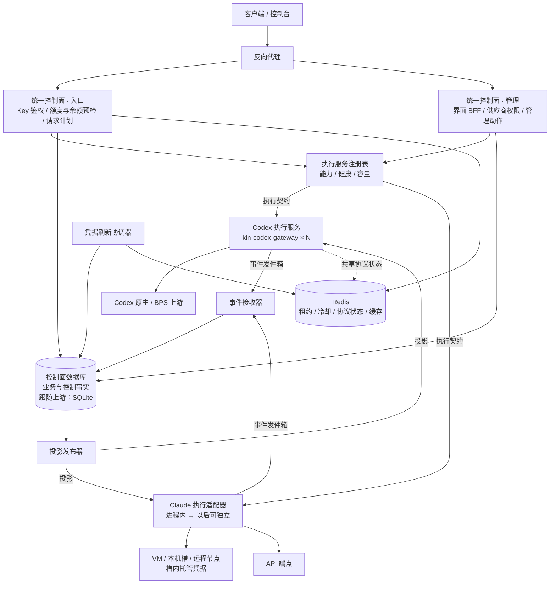

# vm2api 统一控制面与执行服务架构（Claude / Codex 执行分离）

状态：已实施 P1–P6（代码已交付 main，开关默认关闭，见 [control-plane/PROGRESS.md](control-plane/PROGRESS.md) 与 [验收记录](control-plane/ACCEPTANCE.md)）；P2.4 经认可跳过，P5（Redis 共享运行态）已实施、开关默认关闭，P7 不做；生产切换（P1.10、P3.10）未执行。本文不授权生产部署、数据库切换或历史数据迁移，这些仍按 [CHANGE_DELIVERY.md](CHANGE_DELIVERY.md) 单独授权；运维步骤见 [CODEX_GATEWAY_WORKER_SETUP.md](CODEX_GATEWAY_WORKER_SETUP.md) 第 8–12 节。

日期：2026-11-05

关联文档：

- [ARCHITECTURE_TARGET_20261102.md](ARCHITECTURE_TARGET_20261102.md)：PostgreSQL + Redis 的业务事实、请求生命周期、outbox、统计与迁移路线。本文在它之上定义“控制面—执行服务”的边界，数据库与 Redis 的使用规则沿用该文。
- [POSTGRESQL_MIGRATION_PLAN_20261103.md](POSTGRESQL_MIGRATION_PLAN_20261103.md)：SQLite → PostgreSQL 的分阶段实施方案；本文 D8 决定上游表不迁 PostgreSQL；整体迁移的前提与代价以它为准。
- [performance/process-split-plan.md](performance/process-split-plan.md)：主线程减负的第二阶段（网关与控制面拆进程）与 3B（Go 数据面）。本文的执行服务是 3B 的产品化方向，但不替代该文的性能决策门。
- [supplier-platform/15-gateway-worker-final-plan-20261101.md](supplier-platform/15-gateway-worker-final-plan-20261101.md)、[17](supplier-platform/17-gateway-worker-implementation.md)、[18](supplier-platform/18-gateway-worker-node-go-implementation.md)：Gateway Worker 的产品规则、内部协议与当前实现，本文把它作为第一个按契约接入的执行服务。

---

## 1. 决策摘要

用户已确认的方向：

1. **Claude 与 Codex 的执行分开**，各自是独立的执行服务（或执行适配器）。
2. **入口统一**：Key 鉴权、额度与余额预检、计费、界面、供应商权限只有一套。
3. **控制统一**：账号、凭据、BPS 等授权、设置、模型目录、调度策略、请求记录同样只有一套，作为全部数据的源头。

据此形成的架构结论：

| 编号 | 结论 |
| --- | --- |
| D1 | 一套**统一控制面**（vm2api 控制面，单一数据库）持有全部业务数据与控制数据，是唯一事实来源。 |
| D2 | **执行服务**只执行请求：选号、协议转换、调用上游、流式交付、失败处置；保存的只有可重建的运行热状态与待上报事件，不保存业务事实。 |
| D3 | 控制面与执行服务之间只有一份**执行契约**（第 5 节）：投影下发、执行、管理动作、事件上报、健康与容量。入口与界面不感知背后是 Claude 还是 Codex。 |
| D4 | 两个方向的数据流都带版本号且可重放：控制面 → 执行服务是**投影**；执行服务 → 控制面是**事件发件箱**。 |
| D5 | 凭据的事实在控制面（加密保存）；令牌刷新有明确的**刷新归属**，写回带版本校验（第 6 节）。Claude VM 槽位因安全设计保留“槽内托管”，控制面只记元数据与版本（第 12 节）。 |
| D6 | 选号决策留在执行服务（依赖实时状态，必须低延迟）；策略、候选范围与跨实例共享状态由控制面发布（第 7 节）。 |
| D7 | 执行服务在控制面短暂不可用时用已缓存的投影继续接单，事件先存本地，恢复后补交（第 13 节）。 |
| D8 | **数据库跟随上游**：上游仍用 SQLite，上游的表就保持 SQLite；本方案新增的表（事件、游标、凭据、租约、设置版本）也先落在 SQLite（生产峰值每秒 1–2 次业务写，不是瓶颈）。跨实例共享的运行态与协议状态使用 Redis（不触碰上游表，不影响同步）。整体切换 PostgreSQL 只在上游同步迁移或用户明确接受分叉成本时进行（见 15.1）。 |
| D9 | **Codex 先行**：Gateway Worker 已在独立进程，按契约补齐即可。**Claude 后行**：先在进程内套一层适配器实现同一契约，不急于物理拆分，以控制上游同步成本（第 15 节）。 |

不采用的方案及原因：

| 方案 | 不采用的原因 |
| --- | --- |
| 各执行服务各自持有账号与配置（Codex 服务有自己的账号库，再同步回 vm2api） | 供应商归属、分组、模型范围、计费是跨服务事实；分散到多个库后权限与结算需要读镜像，形成双源头和长期一致性负担。 |
| 直接把 CPR（codex-proxy-rs）或 sub2api 当作 Codex 服务 | 丢失已完成的 BPS、计费回执、供应商与分组定制；需要另外维护一套外部系统。Gateway Worker 本来就是按 CPR 逐提交语义移植的“自有 CPR”。 |
| 执行服务成为客户端入口，反向调用 vm2api 鉴权 | 每个请求多一跳、安全边界分散；入口统一的目标反而被打破。 |
| 把全部协议转换搬到执行服务、vm2api 只做透传 | Claude 协议与 `handle-codex.mjs` 等是上游频繁变化的代码，搬进 Go 服务后每次同步都要手工移植，违背“上游优先、最小差异”。 |

---

## 2. 现状盘点（2026-11-05，`main`）

### 2.1 Codex（Gateway Worker 路径）

```text
客户端 → vm2api（handle-codex.mjs：鉴权、协议转换、Key/分组策略）
          → gateway-execution.mjs（选实例、签名）
          → kin-codex-gateway（Go，独立进程，可多实例）
             → chatgpt.com/backend-api/codex（原生） 或 bps.openai.com（BPS）
```

| 项目 | 现在在哪里 |
| --- | --- |
| 账号业务配置（名称、分组、并发、RPM、权重、模型范围、BPS 设置、代理） | 控制面 `vendor_resources.config_json`（`gateway_worker_account`），**控制面是源头**，经投影下发到各 Worker（`/internal/v1/accounts/project`，`projection_revision`）。 |
| 原生与 BPS 令牌 | **只在 Worker** 的 `accounts.json`（配置凭据包密钥时加密）。控制面只有 `credential_revision`、BPS 代次与状态；多实例迁移时用凭据包（`sealCredentialBundle`）在实例间转交。 |
| 令牌刷新 | 每个 Worker 的刷新器各自刷新自己持有的账号；请求内 401 时 BPS 刷新并同号重发。 |
| 运行状态（冷却、额度、错误保护、并发） | Worker 内存与本地文件；心跳上报 `account_credentials`、`account_quotas`、`protection_freezes`、在途数（迁移 086、088、095、097），冻结经控制面在其他实例的心跳策略中下发。 |
| 协议状态（BPS 工具回放、会话目录、续接快照、图片检查点、原生密文签发账号） | Worker 本地 `bps_state/`（按条目分文件）、`route_provenance.json`，只在单个实例内有效。 |
| 请求与用量 | 控制面 `usage_logs`、`request_attempts`；Worker 用响应头 `x-kin-gateway-attempts` 回传尝试摘要，用回执（`receipts/` 落盘 → `/internal/v1/receipts/replay` → `ack`）回传最终用量，控制面对账器结算（`gateway_worker_reconciliation_jobs`）。 |
| 授权流程 | 控制面草稿（幂等键）→ Worker `oauth/start`、`oauth/complete`、`bps/import`；控制面记录授权代次。 |
| 设置与模型目录 | `routing.json` 的 `routing.codex.*`（文件），控制面 `codex-catalog.mjs` 生成 Codex 模型清单；BPS 目录经 Worker 查询后存控制面 `config.bps_catalog`。 |
| 内部安全 | HMAC 签名（`x-kin-gateway-timestamp/nonce/body-sha256/signature`）、nonce 防重放、可选 mTLS。 |

### 2.2 Claude（VM 槽位与 API 端点路径）

```text
客户端 → vm2api（handle-protocol.mjs：官方判定、人设、协议转换、调度 pool-scheduler）
          ├─ VM/本机槽/远程节点：rust cli-hop → Claude kernel → 槽内 Claude Code native_messages → 槽 SOCKS5 → 上游
          └─ API 端点（api-protocol.mjs）：Anthropic/OpenAI 官方 Key、第三方端点
```

| 项目 | 现在在哪里 |
| --- | --- |
| 账号与槽位配置 | 控制面数据库（VM、槽位、代理绑定、分组资源）。 |
| Claude OAuth/Setup Token 凭据 | **槽内托管**：VM/槽位的 CLI 身份与票据，按安全设计不进入 Redis、不在控制面明文流转（见 [RISK.md](RISK.md)）。换票、ensure 由控制面编排、在槽内执行。 |
| API 端点 Key | 控制面加密保存，进程内执行。 |
| 调度与运行状态 | 控制面 Node 进程内（pool-scheduler、quota-gate、unit-circuit、sticky-router 等）。 |
| 请求与用量 | 控制面 `usage_logs`、`request_attempts`、计费。 |

### 2.3 差距总表

| 维度 | 目标 | Codex 差距 | Claude 差距 |
| --- | --- | --- | --- |
| 执行边界 | 执行契约 | 已有约 70%（执行、投影、OAuth、回执、心跳）；缺统一结果格式、通用事件发件箱、设置描述 | 执行与控制在同一 Node 进程，没有契约边界 |
| 凭据事实 | 控制面 | 令牌只在 Worker | 槽内托管（保留，见第 12 节） |
| 刷新归属 | 单一归属 + 版本写回 | 多实例各自刷新，无跨实例归属 | 槽内执行，由控制面编排（已基本符合） |
| 协议状态 | 共享存储 | 单实例本地 | 进程内 |
| 请求记录 | 单一 `model_requests` + attempts | 尝试摘要经响应头、用量经回执，两条通道 | 进程内直接写 |
| 设置发布 | 控制面 revision | `routing.json` 文件热读 | 同左 |
| 跨实例并发 | Redis 租约 | 每实例本地计数，控制面只做展示 | 单进程 |

---

## 3. 目标拓扑



### 3.1 统一控制面的模块

| 模块 | 责任 | 现有代码（迁移来源） |
| --- | --- | --- |
| 入口 | 鉴权、Key/分组/模型策略、额度与余额预检、冻结请求快照（价格、策略、候选范围 revision）、协议入站解析、选择执行服务 | `server.mjs`、`handle-protocol.mjs`、`handle-codex.mjs` 的入口部分、`key-scope.mjs`、`quota-gate.mjs` |
| 执行服务注册表 | 实例注册、能力、健康、排空、容量、按能力与负载选实例 | `gateway-repo.mjs`（`gateway_worker_instances`）、`gateway-execution.mjs` 的 `pickInstance` |
| 投影发布器 | 把账号、凭据封装、设置、策略、模型目录按 revision 下发到执行服务，跟踪确认 | `gateway_worker_projection_jobs`、`projectAccountToAll` |
| 事件接收器 | 拉取并幂等写入执行事件：请求终态、尝试、用量、账号状态、额度、探测、令牌轮换 | 回执对账器、心跳处理（`gateway-routes.mjs`）、`receipt-reconciler.mjs` |
| 凭据与授权 | 加密保存凭据、授权流程（OAuth / BPS / Setup Token / 导入导出）、刷新归属 | `account-management.mjs`、`oauth/`、`codex-slot.mjs` |
| 计费与结算 | 单一请求账本、用量证据、费用、供应商结算 | `relay-billing.mjs`、`vendor-*`、对账器 |
| 管理 BFF | 面板接口、供应商权限、按设置描述渲染服务专属表单 | `panel-routes.mjs`、`gateway-routes.mjs`、`web/` |

### 3.2 执行服务的模块

| 模块 | 责任 |
| --- | --- |
| 投影缓存 | 保存最近一次确认的账号、凭据、设置、策略快照；带 revision；控制面不可用时继续使用 |
| 选号与运行态 | 在投影给出的候选内，按实时状态（在途、冷却、额度、健康）选号；本地热状态 + 共享状态（Redis） |
| 协议执行 | 协议转换（服务专属部分）、调用上游、流式交付、失败分类与处置 |
| 事件发件箱 | 本地持久化（追加日志），按序号对外提供拉取，确认后清理 |
| 刷新执行器 | 在持有刷新租约时刷新令牌并上报轮换事件 |

---

## 4. 数据所有权

原则：**业务事实与控制事实归控制面；执行服务只持有可重建的状态。** 下表“控制面数据库”按 D8 跟随上游（当前 SQLite），表名沿用 ARCHITECTURE_TARGET 的目标命名，落地时映射到现有表（如 `usage_logs`、`request_attempts`）。 执行服务的数据目录被清空后，重新注册、接收投影即可恢复接单；丢失的只有尚未上报的事件（由第 5.6 节的持久化发件箱保证不丢）。

| 数据 | 归属 | 存储 | 下发 / 上报方式 | 备注 |
| --- | --- | --- | --- | --- |
| 用户、Key、分组、钱包、价格、供应商 | 控制面 | 控制面数据库 | 不下发；入口在请求快照中携带必要摘要 | 沿用 ARCHITECTURE_TARGET |
| 账号业务配置（归属、分组、并发、RPM、权重、模型范围、服务专属设置） | 控制面 | 控制面数据库 | 投影（`projection_revision`） | 现状已符合 |
| Codex 原生令牌、BPS 令牌、API Key | 控制面 | 控制面数据库（信封加密） | 投影中的凭据封装（`credential_revision`） | **现状在 Worker，需迁回**（第 6 节） |
| Claude 槽内 OAuth/Setup Token | 槽位（执行侧托管） | 槽内 | 控制面只存指纹、代次、状态 | 安全设计保留（第 12 节） |
| 授权会话（OAuth PKCE、草稿） | 控制面 | 控制面数据库（短期） | 管理动作 | 现状 Worker 也存 `oauth-sessions.json`，迁回控制面 |
| 设置（`routing.codex.*`、BPS 默认、图片策略等） | 控制面 | 控制面数据库 `settings` + `config_revisions` | 投影 / 心跳策略 | 现状为 `routing.json` 文件 |
| 模型目录（Codex 清单、BPS 目录） | 控制面 | 控制面数据库 | 投影；对外由入口生成 `/v1/models` | |
| 调度策略（策略、权重、亲和、等待预算、通道策略） | 控制面 | 控制面数据库 | 投影 + 请求快照 | |
| 选号决策 | 执行服务 | 内存 | 结果经尝试事件上报 | |
| 在途并发 | 执行服务 → 共享 | 本地计数 + Redis 租约 | 心跳上报展示值 | 跨实例强约束需 Redis（第 7 节） |
| 冷却、额度窗口、错误保护冻结、BPS 退避 | 执行服务产生，控制面汇总 | 本地 + Redis（或经控制面再下发） | 状态事件 | 现状冻结经心跳共享 |
| 协议状态：续接快照、工具回放、会话目录、原生密文签发账号、图片检查点 | 执行服务产生 | Redis（加密、TTL）；过渡期本地 | 不进 PostgreSQL | 第 8 节 |
| 请求、尝试、交付、用量、费用 | 控制面 | 控制面数据库（`model_requests`、`request_attempts`、`usage_facts`、`billing_charges`） | 执行事件 | 单一请求账本 |
| 探测记录（BPS 恢复、严格探测） | 控制面 | 控制面数据库 | 执行事件 | 现状经心跳 `bps_probes` |
| 审计 | 控制面 | 控制面数据库 | — | 管理动作在控制面发生 |

---

## 5. 执行契约 v1

执行契约是控制面与任一执行服务之间唯一的接口。Gateway Worker 现有 `/internal/v1/*` 接口是它的前身；v1 以“补齐与统一”为主，尽量不破坏现有接口。

### 5.1 传输与安全

- HTTP/1.1 或 HTTP/2；控制面到执行服务、执行服务到控制面（如需回调）均使用 **mTLS**，证书主体绑定实例 ID。
- 每个请求带签名头：`x-kin-gateway-timestamp`、`x-kin-gateway-nonce`、`x-kin-gateway-body-sha256`、`x-kin-gateway-signature`（HMAC-SHA256，共享密钥按实例分发并可轮换）。时间窗 5 分钟，nonce 在窗口内去重（现有实现）。
- 契约版本：请求头 `x-kin-executor-contract: 1`；执行服务在注册时声明支持的版本范围，控制面按交集选择。字段只做加法；删除字段需要先废弃一个版本。
- 执行服务只接受来自控制面的调用；客户端流量永远经过入口。

### 5.2 注册、能力与心跳

| 接口 | 方向 | 说明 |
| --- | --- | --- |
| `POST /internal/v1/register` | 实例注册（现有接口） | 实例 ID、boot_id、版本、契约版本范围、区域、能力描述 |
| `GET /internal/v1/capabilities` | 控制面 → 执行 | 返回能力描述 |
| `POST /internal/v1/heartbeat` | 执行 → 控制面 | 健康、排空状态、在途、峰值、事件发件箱水位（`events`）；**响应**携带控制面下发的策略增量（冻结、设置 revision、需要拉取的投影） |
| `POST /internal/v1/drain` / `resume` | 控制面 → 执行 | 排空截止时间；排空期间不接新请求，已开始的流按截止时间结束 |

能力描述（示例）：

```json
{
  "provider": "codex",
  "contract": { "min": 1, "max": 1 },
  "operations": ["responses", "chat", "images.generations", "images.edits", "search", "models", "live"],
  "protocols": ["openai.responses", "openai.chat", "openai.images", "openai.search"],
  "transports": { "websocket": true, "upstream_websocket": true },
  "authorizations": [
    { "kind": "oauth", "custody": "control" },
    { "kind": "bps_oauth", "custody": "control", "attach_to": "oauth" }
  ],
  "settings_schema": { "version": 3, "url": "/internal/v1/schema/settings" },
  "account_schema": { "version": 5, "url": "/internal/v1/schema/account" }
}
```

`custody` 说明凭据由谁托管：`control`（控制面保存，经投影下发）或 `executor`（执行侧托管，如 Claude 槽位）。

### 5.3 投影

投影把控制面的事实下发为执行服务的只读快照。

| 接口 | 说明 |
| --- | --- |
| `POST /internal/v1/accounts/project` | 单个账号的全量快照（现有） |
| `POST /internal/v1/projection/batch` | 批量快照，带 `projection_revision` 上下界；执行服务按账号比较版本，只接受更新的 revision |
| `GET /internal/v1/projection/state` | 执行服务当前持有的每个账号的 `projection_revision`、`credential_revision`、`config_fingerprint`（现有 `accounts` 列表的扩展），供控制面对账与补发 |
| `POST /internal/v1/config/publish` | 设置、模型目录、调度策略的发布（带 `config_revision`）；也可经心跳响应提示拉取 |

账号快照字段（在现有投影字段基础上）：

| 字段 | 说明 |
| --- | --- |
| `account_id`、`runtime_account_id` | 控制面资源 ID 与运行 ID |
| `projection_revision` | 单调递增；执行服务拒绝旧版本 |
| `status`、`paused`、`group_ids`、`max_concurrency`、`max_rpm`、`weight`、`model_access` | 业务配置 |
| `provider_settings` | 服务专属设置（如 `bps`），结构由 `account_schema` 描述 |
| `credentials` | 凭据封装（见 5.3.1），`custody=control` 时存在 |
| `credential_revision`、`credentials_by_kind[].revision` | 原生与附加授权各自的代次 |
| `refresh_owner` | 当前持有刷新租约的实例与到期时间（见第 6 节） |
| `proxy` | 出站代理（封装，含认证信息时同样加密） |

#### 5.3.1 凭据封装

- 控制面以**信封加密**保存凭据：每条凭据用随机数据密钥加密，数据密钥用主密钥（KMS 或本机密钥文件，支持轮换）加密。
- 下发时，控制面用**实例公钥**（注册时提交，或 mTLS 证书公钥）重新封装数据密钥，执行服务只在内存中解开。现有 `credential_bundle_key` 的对称凭据包作为过渡方案保留到 P3 完成。
- 执行服务落盘的投影缓存保存的是封装后的密文；实例私钥丢失即等同吊销，控制面重新封装下发即可。

### 5.4 执行

`POST /internal/v1/execute`（现有），WS 帧与关闭为 `/internal/v1/ws/*`，取消为 `/internal/v1/execute/{dispatch}/cancel`。

请求信封（在现有 `Envelope` 上统一字段命名）：

| 字段 | 说明 |
| --- | --- |
| `dispatch`、`request_id`、`attempt_id`、`nonce` | 幂等与关联；`request_id` 对应控制面 `model_requests.id` |
| `operation`、`protocol`、`model`、`stream`、`body`、`headers` | 入站请求（入口已完成鉴权与必要的协议规范化） |
| `scope.group_ids`、`scope.runtime_account_id`、`scope.exclude_accounts`、`scope.session_id` | 候选范围与钉住 |
| `client_scope` | 调用方隔离键（Key 级哈希），用于回放、续接、来源记录 |
| `caller` | 签名的调用方上下文摘要：Key ID、用户 ID、分组 ID、价格快照 ID、`config_revision`；执行服务只用于隔离与日志，不做授权 |
| `scheduling` | 冻结的调度策略（现有 `SchedulingPolicy`：策略、亲和、权重、等待预算、`bps_enabled`、`bps_images`、`route_policy`） |
| `deadline_ms`、`privacy` | 截止时间与隐私策略 |

响应：

- 流式或非流式正文原样交付（控制面负责转回客户端协议）。
- 响应头（现有，统一为契约字段）：`x-kin-gateway-send-state`（`not_sent`/`sent`/`ambiguous`）、`x-kin-gateway-attempts`（尝试摘要）、`x-kin-gateway-account`、`x-kin-gateway-auth-mode`、`x-kin-gateway-service-tier`、`x-kin-gateway-error-category`、`x-kin-gateway-continuation-reason`；流结束后用 trailer 交付诊断。
- **结算以事件（回执）为准**（5.6 的 `request.finalized`）。请求尝试的终态与“是否已交付调用方”以控制面实时视角为准，事件只补齐缺失的尝试与 Worker 侧字段（P2，`result-writer.mjs`）；响应头用于实时交付、尝试的实时写入与“未发送可换实例”的判定。

统一结果（`request.finalized` 事件的载荷）：

| 字段 | 说明 |
| --- | --- |
| `request_id`、`dispatch`、`attempt_id` | 关联 |
| `send_state`、`terminal_state`（`completed`/`upstream_error`/`incomplete`/`cancelled`/`ambiguous`）、`error_code` | 交付事实 |
| `downstream_committed` | 是否已向客户端提交不可撤回的数据（由控制面判定；Worker 载荷不含此字段，事件补齐的尝试按未提交记录） |
| `usage`、`usage_confidence`（`complete`/`partial`/`unknown`） | 用量证据（`partial` 用于 BPS 中断下限结算等） |
| `upstream_model`、`response_model`、`service_tier`、`authorization_mode` | 计价与展示 |
| `attempts[]` | 每次尝试：账号、凭据代次、通道、阶段、状态、类别、发送状态、耗时、上游请求 ID、cf-ray |
| `timing` | 开始、首字节、首 token、结束 |
| `quota` | 本次观测到的额度窗口 |

### 5.5 管理动作

管理动作由控制面 BFF 发起（运营、供应商的权限在控制面校验），执行服务只执行与上游相关的部分。

| 接口 | 说明 |
| --- | --- |
| `POST /internal/v1/oauth/start`、`/oauth/complete` | 授权流程（`grant` 区分 `oauth`、`bps` 等）；PKCE 会话由控制面保存，执行服务只负责与上游换码（因为出站需要账号代理） |
| `POST /internal/v1/accounts/{id}/{action}` | `test`、`refresh`、`quota`、`bps/import`、`bps/models`、`bps/unblock`、`bps/recovery/stop` 等（现有） |
| `GET /internal/v1/schema/settings`、`/schema/account` | 设置描述与账号专属字段描述（JSON Schema 子集 + 界面提示：分组、标签、帮助文本 key、校验范围、条件显示） |
| `GET /internal/v1/models` | 上游模型目录（现有），控制面合并为对外目录 |

P3 之后，授权完成的令牌由执行服务**上报给控制面**（`credential.issued` 事件或同步响应体，二者择一并带幂等键），不再只留在执行服务本地。导出账号文件改为由控制面直接从自己的数据库读取，不再调用执行服务的 `credentials` 接口。

### 5.6 事件发件箱

现有的回执（`receipts/` + `replay` + `ack`）与心跳中的状态字段合并为一条事件流（P1 已实现：Worker `events.go`、`events_http.go`，控制面 `src/lib/executor/event-ingest.mjs`）。

| 接口 | 说明 |
| --- | --- |
| `GET /internal/v1/events?after={seq}&limit={n}&stream_id={id}` | 按流内单调序号拉取（每次最多 1000 条）；返回 `stream_id`、`head`、`acked`、`next` 与事件数组。带的 `stream_id` 不是当前流时返回 409 与新 `stream_id` |
| `POST /internal/v1/events/ack` `{stream_id, seq}` | 确认到某序号；重复确认幂等，超过 head 返回 400；执行服务据此清理 |
| 心跳与健康接口中的 `events` | `{stream_id, head, acked, backlog_bytes, healthy, error}`，控制面据此监控积压 |

事件流：Worker 在数据目录 `events/` 首次创建时生成 `stream_id`，重启沿用，数据目录重建即换一条新流（序号从 1 开始）；控制面按 `(instance_id, stream_id)` 维护游标（表 `executor_event_cursors`）。

事件信封：

```json
{
  "event_id": "evt_<stream_id>_<seq>",
  "stream_id": "…",
  "instance_id": "gw-1",
  "seq": 1024,
  "type": "request.finalized",
  "version": 1,
  "occurred_at": "2026-11-05T01:02:03.456Z",
  "subject": { "dispatch_id": "…", "request_id": "…", "runtime_account_id": "…" },
  "payload": { },
  "payload_sha256": "<载荷按键排序紧凑编码的 sha256>"
}
```

事件类型：

| 类型 | 阶段 | 载荷 | 控制面处理 |
| --- | --- | --- | --- |
| `request.finalized` | P1 | 与回执相同（含 `payload_hash`） | primary：经 `ingestReceipt` 入库并进入对账结算；P2 起由统一结果写入器写尝试与用量 |
| `account.state` | P1 | 本实例全部账号的凭据与 BPS 终态快照 `{items}`（整体替换，有变化才产生） | primary：`recordRuntimeCredentials` + BPS 403 移组 |
| `account.quota` | P1 | 有变化的账号额度 `{items}` | primary：`recordRuntimeQuotas` |
| `probe.recorded` | P1 | 一次 BPS 恢复探测记录 | primary：`recordBpsProbes`，不进使用记录 |
| `credential.rotated` | P3 | 账号、授权类别、旧代次、新代次、新凭据封装（用控制面公钥加密） | 按 `expected_revision` CAS 写入；成功后投影到其他实例；失败返回冲突（第 6 节） |
| `credential.issued` | P3 | 授权完成的凭据（同上加密） | 由授权草稿关联写入 |

不做成事件的内容：在途与峰值、错误保护冻结仍随心跳上报（它们是实时协调信号，不需要重放）；订阅到期由控制面主动查询后同步写入，不需要事件。

规则：

- **持久化**：执行服务先把事件追加到分段日志并 fsync 才算产生（控制面明确不消费时不逐条 fsync，日志只供排障，终审 A6），再对外提供拉取；启动时截掉崩溃留下的残缺或摘要不符的尾部；流标识文件丢失时沿用分段里的流标识；写入故障在维护周期（10 秒）内自动尝试恢复。
- **是否必需**：控制面在心跳响应中下发 `executor_events.required`（`KIN_EXECUTOR_EVENTS` 为 shadow / primary 时为真；旧版控制面不下发视为假）。另下发 `enforce`（只有 primary 为真）：必需且 enforce 时，写入失败或未确认积压超过 512 MiB 会让 Worker 显示 `degraded` 并以 503 `executor_event_log_unavailable`（`not_sent`）拒绝新请求；shadow 只保留事件、不自行确认，也不因日志故障拒单（终审 A5）。控制面开始消费时（必需转为“是”），Worker 补发一份完整账号终态快照（终审 A10）；不必需时 Worker 自行确认到最新序号，日志只保留 24 小时，写入故障不影响接单。进程启动后、收到第一份心跳策略前为“未知”：既不自行确认（控制面可能还没拉取重启前的事件），也不因事件拒单；“未知”持续超过 24 小时（心跳一直拿不到策略）按不必需处理；不接控制面的 Worker 启动即为不必需。
- **幂等**：控制面以 `event_id` 去重（表 `executor_event_inbox`），回执入库按（实例, dispatch）幂等；重复拉取不重复处理。
- **顺序与起点**：同一流内按 `seq` 严格有序；控制面从 max(本地游标, Worker 已确认序号) 开始，不重放 Worker 已自行确认的历史；处理异常的事件不推进游标，下一轮重试，同一事件连续失败 5 次后记为 `failed` 并跳过；序号缺口先不确认、下一轮重试，连续 5 轮仍在才接受并告警（终审 A5、B3）；信封无效的事件记为 `invalid` 并跳过（回执重放与下一次快照兜底），同时告警。`account.state` 只应用不早于已应用快照的事件（按纳秒数值比较时间，终审 A4）。
- **回滚检测**：Worker 数据目录从旧快照恢复后，流标识不变、序号回退，新事件会复用已处理过的序号与 `event_id`。控制面每次拉取多取游标所在的那一条：内容与已入库的不同，或 Worker 的 head 小于游标，即判为回滚，从 Worker 已确认的位置重新处理；同一 `event_id` 内容不同的事件以带内容摘要的派生 ID 入库。游标超过 Worker head 时事件链路不算健康，心跳继续兜底（终审 A3）。跨实例不保证顺序，依赖业务版本号裁决。
- **心跳兜底**：primary 下只有该实例事件链路健康（Worker 报告 `required` 且 `healthy`；控制面 60 秒内成功推进或拉取过当前流，卡在失败事件上不算；近 5 分钟内没有被跳过的账号终态快照）时，心跳才停写账号终态、额度与探测；否则仍按心跳写入。
- **摘要口径**：载荷按键排序的紧凑 JSON 计算 sha256；Go 会把 U+2028/U+2029 转义，控制面校验时做同样处理；超过 2^53 的整数在控制面按无效事件处理。
- **来源可信**：事件页通过带 HMAC 签名的内部请求拉取，跨主机部署要求 mTLS。Worker 对事件页与账号导出响应签名（P3.11，终审 B3）：HMAC 覆盖 `resp`、状态码与完整请求目标（路径与查询串）、本次请求随机串、正文摘要与正文（响应头 `X-Kin-Gateway-Response-Sha256` / `-Signature`）。控制面验签失败即视为拉取失败；签名绑定请求随机串，旧响应不能重放给另一次拉取。
- **性能**：每条事件 fsync 后才返回，读取时持有日志锁；按当前流量（每分钟约百次分发）足够，流量上升后改为分段偏移索引与锁外读取。
- **保留**：已确认的整段在 24 小时后删除；收件箱保留 7 天。
- **兼容迁移**：控制面开关 `KIN_EXECUTOR_EVENTS=off|shadow|primary`（默认 `off`）。shadow 只比对（`request.finalized` 对回执 `payload_hash`，`probe.recorded` 对探测记录；快照类事件只记录），primary 以事件为主来源、心跳不再写同类字段、回执重放保留为幂等兜底。生产以 primary 观察一个发布周期后删除回执接口与心跳重复字段（P1.10，需授权）。

### 5.7 健康、排空与容量

- 沿用现有判定：控制面 45 秒未收到心跳即把实例置为 `offline`，不再分配新请求；来源实例 90 秒未心跳时，其上报的冻结不再下发给其他实例。
- 容量：执行服务声明 `max_inflight` 与当前在途；入口选实例时按能力匹配 + 负载 + 账号投影所在实例。
- 排空：滚动升级时先 `drain`，等待在途结束或截止时间，再停止；事件发件箱在退出前必须清空或保证落盘。

### 5.8 错误码约定

执行服务对控制面返回的错误分三类，控制面据此决定能否换实例：

| 类别 | `send_state` | 控制面动作 |
| --- | --- | --- |
| 未发送（容量满、无账号、未连上上游、投影缺失） | `not_sent` | 可以换实例重试 |
| 已发送失败 | `sent` | 不跨实例重放；按投影后的客户端错误交付 |
| 结果不明 | `ambiguous` | 不重放；等事件或对账 |

---

## 6. 凭据与令牌刷新

### 6.1 目标

- 控制面是令牌的唯一事实来源；执行服务持有的是投影副本。
- 同一刷新令牌在任一时刻只被一个实例使用（OpenAI 刷新令牌是一次性轮换，多实例同时刷新会导致其余实例的令牌失效）。

### 6.2 刷新归属（Refresh Lease）

```text
执行服务 A 发现令牌即将过期（或请求内收到 401）
  → 向控制面申请刷新租约：POST /internal/v1/credentials/{account}/{kind}/lease {expected_revision}
     · 控制面原子获取（Redis 未引入时用 SQLite 租约表的单写事务；P5 后可改 Redis） lease{holder=A, revision, token, ttl=60s}
     · 已被他人持有 → 返回 holder 与到期时间；A 等待新投影或在到期后重试
  → A 用投影中的刷新令牌刷新上游
  → A 产生 credential.rotated{expected_revision, new_revision, 新凭据封装}
     · 同步路径：直接调用 POST /internal/v1/credentials/{account}/{kind}/rotate（请求内 401 需要立即生效）
     · 异步路径：写入事件发件箱
  → 控制面 CAS 写入；成功则释放 lease，向其他实例投影新凭据
  → A 用新令牌重发（请求内路径）
```

规则：

- 刷新失败且上游明确拒绝刷新令牌（400/401）时，上报 `account.state{invalid}`，控制面把该授权标记为需重新授权，不再发放租约。
- 租约到期未写回时，控制面认为刷新结果不明：先向持有者查询（`GET /internal/v1/credentials/{account}/{kind}/pending`），仍不明时标记“需人工确认”，不自动发放新租约以免重复使用刷新令牌。
- 定时预刷新由控制面的刷新协调器统一调度：按账号选择一个健康实例（优先账号代理所在区域）发放租约，避免所有实例同时预刷新。
- BPS 授权、原生授权各自独立的租约与代次。
- 迁移期间（凭据仍在 Worker），刷新租约先行上线，即可消除多实例并发刷新问题。

**当前实现（P3.1–P3.2，凭据仍在 Worker 期间）**，与上面的目标流程有以下差别，后续任务补齐：

- 开关：控制面 `KIN_REFRESH_LEASE=on` 时，心跳策略下发 `refresh_lease.required=true`；未下发（旧版控制面）或为假时 Worker 照旧自行刷新。
- 接口与注册接口同目录、同样签名：`POST /internal/v1/gateway/workers/credentials/lease`（`instance_id`、`runtime_account_id`、`grant`=`native`/`bps`、`credential_revision`、`token_fingerprint`）与 `.../credentials/release`（`lease_token`、`outcome`=`rotated`/`failed`/`terminal`，`rotated` 时附新代次与新令牌指纹）。
- 写回：`rotated` 时 Worker 附带新凭据包（实例间共享密钥加密）、轮换前代次与令牌指纹。控制面以凭据库托管令牌（`KIN_CREDENTIAL_CUSTODY=control`）时据此 CAS 写入凭据库：原生授权按代次，BPS 授权按轮换前令牌指纹（P3.6）；随后从持有者导出、按目标实例封装投影。worker 托管时只做投影。
- 过时判断：原生授权比较凭据代次。BPS 授权用令牌代次 `token_generation`，Worker 在每次授权、导入、刷新时递增，并随投影同步（R3 审查 P1-2）。另外比较刷新令牌指纹（SHA-256 前 8 字节，迁移 105）：指纹不同、且代次不高于最近一次轮换时拒绝（`stale_token`），并从轮换后的持有者投影新凭据（同一账号 30 秒内一次）。
- 结果不明（R3 审查 P1-4）：Worker 用 httptrace 判断换票请求是否已完整发出。已发出却没拿到完整响应时报告 `ambiguous`；控制面把租约改为 `ambiguous` 并保持 10 分钟，期间任何实例都拿不到租约（`outcome_unknown`）。之后的第一次刷新会得到明确结果：令牌已被轮换就判失效，否则正常成功。同一实例在租约有效期内也不能重复申请。单次报告的代次增幅超过 1000 被拒（`revision_jump`）。
- Worker 被拒（`lease_held` / `stale_revision` / `stale_token`）时不使用手里的刷新令牌，最多等待 20 秒（不超过本次刷新时限）看投影是否送来新凭据；控制面不可达时本次不刷新。这两种情况都不计入“恢复窗口耗尽判过期”。
- 预刷新指派（P3.3）：心跳策略 `refresh_lease.designated` 列出指派给本实例做定时预刷新的运行账号。每个账号取在线实例中凭据代次最高者，同代次按实例 ID 取第一个；实例离线后，下一次心跳即改派。未指派的账号本实例不做定时刷新，等投影送来新凭据。请求内 401 与手动刷新不受指派限制，仍按租约互斥。暂不按代理区域选择实例。
- 租约 60 秒到期后可重新申请。上游拒绝刷新令牌时，由 Worker 本地标记失效并停止自动刷新，控制面不再另行停止发放租约。

**凭据托管的当前实现（P3.4–P3.9）**：

- 开关 `KIN_CREDENTIAL_CUSTODY=worker|control`，默认 `worker`，即令牌以 Worker 为准，与过去相同。
- 凭据库 `executor_credentials`（迁移 106，`src/lib/executor/vault.mjs`）采用信封加密：
  - 每条记录用随机数据密钥做 AES-256-GCM 加密，数据密钥再由主密钥包裹；
  - 两层附加认证数据都绑定账号、授权类别与代次；
  - 主密钥文件与数据库同目录（`credential-master-keys.json`，0600），用 `scripts/rotate-credential-master-key.mjs` 轮换；
  - 明文不落库。
- 实例托管密钥（迁移 107，Worker `custody.go`）：
  - Worker 在数据目录生成 X25519 密钥对，公钥随注册与心跳提交；
  - control 模式下，控制面按目标实例公钥封装 `custody_bundle`（临时 X25519 + HKDF-SHA256 + AES-256-GCM，绑定实例与运行账号），只有该实例能解开；
  - 目标实例没有公钥（旧版 Worker）或凭据库还没有该账号时，回退到共享密钥凭据包并告警。
- 收录（`credential.issued`）：control 模式下每次从 Worker 导出账号时，原生授权代次或 BPS 授权代次更高才写入凭据库。授权、导入、重新授权都会提高代次，旧副本不会覆盖新令牌。
- 投影安全（R3 审查 P1-1、P2-1、P2-2）：
  - 封装前比较凭据库与来源副本的代次。凭据库缺失或更旧（收录失败）时回退到来源副本，绝不下发“旧令牌 + 新代次”。
  - 导入的代次以凭据库为准。
  - 来源没有 BPS 授权时，不带凭据库里的 BPS 令牌；撤销 BPS 授权时，凭据库里的 BPS 记录一并删除。
  - 附加认证数据绑定两种代次；Worker 拒绝低于本地代次的托管投影。
  - 目标实例能力描述里没有 `custody`（旧版 Worker、回滚）时，回退到共享凭据包。
- 主密钥文件（R3 审查 P1-3）：
  - 凭据库已有记录时，文件缺失直接报错，不静默生成新密钥；
  - 遇到不认识的主密钥 ID 时重读文件，所以可以在线轮换；
  - 写文件时 fsync，轮换前自动备份。
- 实例托管公钥固定（TOFU，R3 审查 P1-5）：
  - 上报的公钥一律先记为待确认（迁移 110），管理员在「Gateway Worker」页核对指纹并确认后才固定；新实例 ID 的首个公钥也一样（终审 B2）。控制面自己拉起的同机 Worker 例外：控制面从本机数据目录读出它的公钥，直接固定。待确认期间投影回退到共享凭据包。注册请求不能自报 `admission_state`。
  - **信任边界**：所有 Worker 共用一个内部令牌和一个凭据包密钥。只持有内部令牌的一方可以冒充实例调用内部接口，但拿到的只有共享密钥加密的凭据包（需要凭据包密钥才能解开），也拿不到托管封装（新公钥要管理员确认）；同时持有凭据包密钥即可解开全部共享凭据包。托管封装防的是“凭据库令牌被静默发往未经确认的公钥”。
  - **退出计划**：按实例分发内部凭据（HMAC 密钥或 mTLS 证书主体与 `instance_id` 绑定），上行的轮换包改用控制面公钥加密，然后删除共享凭据包路径。
- 兼容保留与移除条件：
  - 目标实例没有托管公钥或 `custody` 能力时，回退共享凭据包：所有 Worker 都升级到带 P3.5 的版本、心跳都带托管公钥后删除。
  - 旧版 Worker 不交回授权会话：所有 Worker 升级到带 P3.7 的版本后删除。
- **凭据库重建投影（终审 A9 的退出，最终审计 F1 已实现）**：投影优先从在线的来源实例导出（取运行状态与凭据包），凭据库决定下发哪一份令牌。其他持有该账号的实例都超过 45 秒没有心跳（或已标记 offline）、或明确没有该账号、且目标实例确实没有该账号（本实例返回 `account_not_found`、心跳回报里没有它，或本实例没有绑定）时，control 托管直接用凭据库令牌加控制面账号资料（email、ChatGPT 账号 ID、套餐、代理）生成导入请求：目标实例托管公钥可用时按公钥封装，否则用实例间共享凭据包；代理放在凭据包里；账号先以停用状态导入，随后的 PATCH 下发完整配置并启用。凭据库原生代次低于绑定或刷新租约记录的最高代次（轮换报告丢失）时不重建，维持 drifted；只有 BPS 落后时只重建原生授权。有在线实例只是导出失败时不重建（它可能持有更新的令牌）。来源实例才有的运行状态（额度观测、冷却、Cookie 等）不随重建恢复，由后续请求重新观测。worker 托管（默认）下凭据只在 Worker，单 Worker 数据目录丢失仍需重新导入或重新授权。
- 迁移（P3.8）：`scripts/migrate-worker-credentials.mjs` 先只读演练，`--apply` 才写入并审计；Worker 上的令牌保留，作为投影缓存。
- 账号导出（P3.9）：
  - control 模式读凭据库，worker 模式解开 Worker 导出的凭据包；
  - Worker 的明文凭据接口 `GET /internal/v1/accounts/{id}/credentials` 已删除。

### 6.3 授权流程

- 授权会话（PKCE verifier、state、草稿）保存在控制面；执行服务只负责与上游的授权码交换（需要账号代理出站）。
- 交换得到的令牌经 `credential.issued`（或同步响应）交给控制面写入，控制面再投影给负责该账号的实例。
- 当前实现（P3.7）：
  - 控制面生成 `session_id`、`state` 与 PKCE verifier，随开始请求交给 Worker；
  - Worker 补上账号安装身份并构造授权链接，把会话原样交回，不落盘，启动时还会删除旧版本留下的 `oauth-sessions.json`；
  - 控制面把会话保存在 `gateway_worker_oauth_sessions.session_json`（迁移 108；配置数据库密钥 `TAPMODELS_DB_SECRET` / `KIN_DB_SECRET` 时加密，否则明文，终审 B6），完成时随请求交回，完成或过期（10 分钟）后清空；
  - 同一草稿的完成请求由控制面串行处理；
  - 旧版 Worker 不交回会话、仍自行保存，控制面照常完成。升级顺序：先升级控制面，再升级 Worker。
- 导入授权文件：控制面校验格式后直接写入凭据，再投影；签发客户端、`chatgpt_account_id` 一致性、Free 拒绝等上游相关校验由执行服务的校验接口完成（`POST /internal/v1/credentials/validate`）。

---

## 7. 调度与运行状态

| 层 | 内容 | 位置 |
| --- | --- | --- |
| 策略层 | 策略、权重、亲和、等待预算、通道策略、BPS 名单、模型范围 | 控制面发布（投影 + 请求快照） |
| 候选层 | 请求范围内的账号集合（分组、模型、排除、钉住） | 入口按快照确定，执行服务在投影内求交集 |
| 运行层 | 在途、冷却、额度窗口、错误保护、健康、延迟 | 执行服务本地热状态；跨实例共享部分进 Redis |
| 决策 | 选号、同号重试、换号、换通道 | 执行服务 |

跨实例共享：

- **并发上限**：账号 `max_concurrency` 是跨实例总上限时，需要 Redis 租约（带持有者令牌与过期时刻）。在 Redis 上线前，按实例数均分或只把账号投影到一个主实例（现状实际上接近后者：选实例时优先账号绑定的实例）。
  - 当前实现（P5.2）：本地准入后取共享租约，被拒时撤回准入、排队等待。租约在准入时控制；Redis 短暂不可用期间准入的请求记为无令牌租约，恢复后补登记。续期发现令牌丢失时补登记，不取消在途请求（中途取消会伤害调用方并浪费上游用量），因此 Redis 故障恢复的短时间内合计并发可能超过上限，计数恢复前新的准入会被拒。这是对原设计“续期失败即取消执行”的修订。
- **冷却与冻结**：现状由心跳上报、控制面汇总后经其他实例心跳下发（迁移 086）。Redis 上线后，执行服务直接读写共享限制，控制面只做展示与审计。
  - 当前实现（P5.3）：两条通道并存。心跳通道服务没有 Redis 的部署；有 Redis 时冷却、冻结与 BPS 退避约 1 秒传播。错误保护冻结的提前解除经 Redis 约 1 秒传播，但心跳下发的 PeerFreeze 要等下一次心跳（约 15 秒）才清掉。移除条件：Redis 成为多 Worker 部署的必需项后，删除错误保护冻结的心跳通道。
- **额度窗口**：执行服务观测、上报；控制面保存快照，作为跨实例的候选过滤依据。

---

## 8. 协议状态

| 状态 | 现状 | 目标 |
| --- | --- | --- |
| BPS 工具回放、会话工具目录 | `bps_state/`，2 小时 | Redis，键含账号/调用方/会话/授权代次，值加密，TTL 2 小时 |
| BPS 续接快照 | 同上，2 小时 | Redis，同上；单条上限 12 MiB，超限不保存 |
| 原生密文签发账号记录 | `route_provenance.json`，24 小时 | Redis，键为（调用方范围 + 密文）的 SHA-256，TTL 24 小时 |
| 图片策略检查点 | `bps_state/` | Redis |
| 原生 WS 续接 | 进程内连接池 | 保留进程内（连接本身不可迁移）；入口按 `connection_key` 亲和到同一实例 |

过渡期（Redis 未上线）：入口按 `session_id` / `prompt_cache_key` / `previous_response_id` 把同一会话亲和到同一执行实例，与现状一致；实例失联时续接回退为“要求客户端重发完整历史”（`previous_response_not_found`）。

**当前实现（P5，2026-11-05）**：设置 `KIN_REDIS_URL` 后，上表 Redis 一列已实现（`shared_bps_state.go`、`route_provenance.go`），并增加跨实例账号并发租约（`shared_concurrency.go`）与冷却、冻结、BPS 退避共享（`shared_holds.go`）。协议内容以凭据包密钥派生的密钥加密，附加认证数据为 Redis 键；Redis 不可用时各项退回本地行为，恢复后自动回到共享。未设置时保持上面的过渡期行为。运维见 [CODEX_GATEWAY_WORKER_SETUP.md](CODEX_GATEWAY_WORKER_SETUP.md) 第 13 节。

协议状态全部可丢：丢失只会让续接或回放降级为完整历史，不影响计费与业务事实，因此不进入控制面数据库。

---

## 9. 请求记录与计费

- 入口在请求开始时创建 `model_requests`（冻结价格、策略、候选范围 revision），生成 `request_id` 并随信封下发。
- 执行服务的每次尝试与最终结果通过 `request.finalized` 回传：回执入库并进入对账结算；请求尝试先由控制面按响应头实时写入（带控制面视角的终态），60 秒后由事件补齐缺失的尝试与 Worker 侧字段。
- 计费口径：
  - 成功请求按完整用量结算；纠正轮等内部轮次的用量并入最终 usage。
  - 失败、截断、取消原则上不计量；**BPS 中断**（截断、取消、复制中断结果不明）与**断流后本地补出的完成**按执行服务累计的 `partial` 用量下限结算；补完成的回执带 `bps_cutoff_completed`；实时路径记为截断的 BPS 请求也等回执结算；没有任何用量时控制面明确记为不计量、不进死信（已实现的规则，见发布说明 2026-11-05 与最终审计 C1）。
  - 未知用量保持 `unknown`，不能以 0 结算。
- 幂等键：`request_id`（一次客户端请求一个账本条目）；上游 `x-request-id` 按尝试记录，用于对账与排障，不作为账务主键（一次请求可能包含压缩轮与生成轮等多次上游调用）。
- 实时路径与事件路径的分工：入口在流结束时用响应头与流内观测给出实时日志；最终结算以 `request.finalized` 为准，二者以 `request_id` 合并（现有“实时日志 + 回执对账”机制的推广）。

---

## 10. 设置、模型目录与配置发布

- `routing.json` 中与执行相关的设置（`routing.codex.*` 等）迁入控制面数据库 `settings`（只迁本地键，见 15.1），每次修改推进 `config_revision` 并写审计（ARCHITECTURE_TARGET 第 8 节的事务顺序）。
- 执行服务收到的设置来自投影或心跳响应，带 `config_revision`；请求信封中的 `caller.config_revision` 用于诊断“请求按哪一版配置执行”。
- 模型目录：执行服务提供上游目录（`/internal/v1/models`、BPS 目录）；控制面合并模型策略、分组范围、BPS 能力收窄后生成对外 `/v1/models`。目录查询结果缓存在控制面，不在请求路径上实时访问执行服务。
- 服务专属设置的界面由 `settings_schema` 描述生成；控制面保存值并校验（同一 schema 在服务端校验，不能只靠前端）。

---

**当前实现（P4，2026-11-05）**：

- 设置存储：本地 8 个键（见计划附录 A）不再写进 `routing.json`，`normalizeCodexRouting` 与其他上游函数恢复为上游原样。
  - 值保存在 `executor_settings`（迁移 109），每次修改都在 `config_revisions` 推进设置版本 `settings_revision`，并写审计（含改动前后的值）。
  - 该版本与上游 `usage_logs.config_revision`（`routing.json` 运行配置版本）不是一回事，所以改用不同的名字。
  - 导入：控制面启动与从备份恢复时，在加载 `routing.json` 之前导入这些键。数据库已有设置时，忽略文件里的值并告警。之后先把原文件备份为 `routing.json.bak-<时间>`，再删除这些键（R4 审查 P0-1、P1-4）。
  - 请求路径的读取缓存 1 秒；读取出错时保留上一份有效值并告警。数据库未打开时使用默认值。
  - 保存：补丁里的对象按键合并一层（调度权重再合并一层）。被条件隐藏的依赖字段按联动规则收敛：
    - 关闭 403 自动停用时，同时关闭自动恢复；
    - 改小图片张数时，提醒余量与压缩预留随之收敛。
  - 保存带 `expected_revision` 乐观锁，版本不一致返回 409。
- 设置描述（P4.4）：
  - `src/shared/executor-schema/codex-settings.json`、`codex-account.json` 定义字段、类型、范围、分组、条件显示与文案 key。
  - 控制面保存时在服务端按描述校验，非法值整体拒绝，并返回每个字段的错误。账号 BPS 设置同样按 `codex-account.json` 校验，沿用原有的细分错误码。
  - Worker 内嵌同一份描述（测试保证逐字节一致），经 `GET /internal/v1/schema/settings`、`/schema/account` 提供，并在能力描述中报告版本；版本不一致时控制面告警。
- 配置发布（P4.3）：
  - 心跳策略带 `settings_revision`，与策略里的设置值来自同一快照；Worker 记录已应用的版本，并在健康接口与心跳中报告。
  - 每个 Gateway 请求只取一次设置快照，信封 `scheduling.settings_revision` 带上该版本；Worker 写进回执与 `request.finalized`。
  - 控制面在请求尝试 `request_attempts.settings_revision`（迁移 111、112）记录同一版本。
- 模型目录（P4.5）：
  - `/v1/models` 只读控制面缓存：上游目录同步与账号上保存的 BPS 目录。
  - 对账循环每 30 分钟检查一次，补查 6 小时未更新的 BPS 目录。

---

## 11. 界面与管理流程

- 面板接口全部在控制面；供应商权限、资源归属、能力开关在控制面校验后，才调用执行服务的管理动作。
- 账号向导按能力描述的 `authorizations` 生成：Codex 账号显示“OAuth / 账号文件”与可选的“添加 BPS 授权”；Claude 账号显示槽位相关流程。
- 账号专属字段（如 BPS 分区）由 `account_schema` 描述；现有手写组件（`bps-section.tsx` 等）在 P6 之前保留，逐步替换为 schema 渲染，替换完成后删除手写组件与重复文案。
- 运营可见的运行信息（在途、冷却、暂停原因、下次探测、额度）来自控制面汇总的运行投影，不直接查询执行服务。
- 导出/导入账号文件：P3 之后由控制面直接读写自己的凭据存储；导出继续要求确认与审计。

- 当前实现（P6，2026-11-05）：
  - 通用表单 `web/src/components/schema-form.tsx` 按设置描述渲染：分组、条件显示、各类型控件、即时校验与文案 key。宿主可为个别字段提供专用控件。
  - 设置页的 Codex 执行设置 `codex-executor-settings-section.tsx` 与账号 BPS 设置 `bps-section.tsx` 都由描述生成；BPS 的模型名单与移入分组用专用控件。
  - 原手写组件（调度、预热、重置卡、BPS 默认模板、BPS 图片）已删除，文案沿用原有 key。
  - 账号向导按在线 Worker 能力描述中的 `authorizations` 决定是否提供“添加 BPS 授权”步骤；旧版 Worker 不报告该字段时按全部支持处理。

---

## 12. Claude 接入

### 12.1 方式：先进程内适配器

```text
入口（统一） → 执行服务注册表 → ClaudeExecutor（进程内，实现执行契约的同一组接口）
                                    ├─ handle-protocol.mjs 的执行部分（人设、kernel 信封、流处理）
                                    ├─ pool-scheduler 等选号逻辑
                                    └─ rust cli-hop / API 端点
```

- 进程内适配器实现与 5.4 相同的执行接口与 5.6 相同的事件类型（直接写入事件接收器的内存队列，不经网络），使入口与计费只面对一种结果格式。
- 选号与运行态仍在 Node 进程内；凭据仍在槽内。
- 是否物理拆分由 [process-split-plan.md](performance/process-split-plan.md) 的决策门决定（主线程是否仍饱和、请求量是否增长）。拆分时把适配器换成网络实现即可，入口与计费不变。

### 12.2 凭据托管

- Claude OAuth / Setup Token 在 VM 槽位内由 CLI 持有，这是现有安全设计（凭据不出槽、不进 Redis）。能力描述中声明 `custody: executor`。
- 控制面保存：凭据指纹、代次、到期时间、状态、最近一次换票结果；换票、ensure、初装等操作由控制面编排、在槽内执行，结果通过 `credential.rotated`（只含元数据，不含令牌）回报。
- API 端点 Key 已在控制面加密保存，`custody: control`，与 Codex 相同。

### 12.3 不迁移的部分

- 官方 Claude Code 判定、人设、计费头与身份块处理等属于上游主体代码，保留在 vm2api 原位置，由适配器调用；本架构不复制或改写这些逻辑。

---

## 13. 故障与降级

| 故障 | 行为 |
| --- | --- |
| 控制面短暂不可用 | 入口本身不可用，因此没有新请求；已在执行的流继续完成，事件留在执行服务本地发件箱，恢复后补交 |
| 控制面可用、执行实例失联 | 注册表不再分配该实例；未发送的请求换实例；已发送的请求按 `ambiguous` 等待对账；该实例的冻结记录失效 |
| 执行实例重启（数据目录保留） | 用缓存投影恢复；未确认事件继续提供拉取；事件流 `stream_id` 不变，控制面沿用游标 |
| 执行实例重建（数据目录丢失） | 重新注册、重新接收投影；未上报事件丢失 → 由入口实时日志兜底，相关请求标记 `usage_confidence=partial/unknown` 并进入对账告警 |
| 事件积压 | 心跳暴露积压水位；超过阈值告警；超过硬上限时执行服务停止接新请求 |
| 投影缺失或过期 | 执行服务对该账号返回 `not_sent`（`projection_unavailable`），入口换实例或报错；控制面补发投影 |
| 刷新租约冲突 | 非持有者不刷新；令牌过期期间该账号对该实例不可用，入口换号 |
| Redis 不可用 | 需要跨实例强约束的并发、冷却退化为“只投影到主实例”的模式；协议状态退化为会话亲和；不影响计费 |
| 控制面数据库不可用 | 入口拒绝新的需鉴权或计费的请求（ARCHITECTURE_TARGET 第 9 节）；执行服务事件本地暂存 |

---

## 14. 安全

- **密钥**：主密钥支持轮换（新数据密钥用新主密钥，旧密文按需重封装）；实例密钥对按实例生成，私钥只在实例内；共享 HMAC 密钥按实例分发并可轮换。
- **最小权限**：执行服务只能收到投影给它的账号的凭据；控制面按“账号 → 实例”分配下发，不把所有凭据发给所有实例。
- **审计**：授权、导入、导出、解除停用、凭据轮换、刷新租约冲突都写审计；导出账号文件需要确认并记录导出范围。
- **脱敏**：事件载荷中的上游错误、诊断限制大小并脱敏；凭据只出现在加密封装中。
- **网络**：执行服务的内部端口只对控制面开放；mTLS 证书主体与实例 ID 绑定。

---

## 15. 上游同步策略

| 范围 | 归属 | 策略 |
| --- | --- | --- |
| Claude 协议、人设、官方判定、VM/槽位、kernel | 上游 `dofastted/vm2api` 主体 | 原位置保留；适配器只调用，不复制；同步时只处理适配器调用点的冲突 |
| `handle-codex.mjs` 的协议转换 | 上游 | 保留在 vm2api 入口；执行服务只接收规范化后的 Responses 请求 |
| Gateway Worker、BPS、执行契约、事件接收器、投影发布器、刷新协调器 | 本地定制 | 自由演进；按“单一定制提交”规则交付 |
| 数据库迁移 | 本地定制编号 | 新迁移按现有编号顺延；不改写已应用迁移 |

契约层的引入应让后续同步冲突减少：上游改动集中在入口与 Claude 执行内部，本地改动集中在注册表、投影、事件与 Worker。

### 15.1 保持可同步的硬约束（2026-11-05 用户确认）

最终目标是“按本方案完成后，仍能按现有流程同步、合并上游”。以下约束对每个实施任务生效，违反即停止并请用户决定：

1. **上游代码不搬家，只加接入点。** Claude 适配器调用现有函数；统一账本只在上游写使用记录与计费的位置增加一处调用。不复制、不改写上游的协议、人设、调度与 VM 逻辑。
2. **数据库跟随上游**（D8）。不把上游的表迁到 PostgreSQL；不改写上游迁移；本地迁移按编号顺延。
3. **设置只迁本地键。** `routing.codex` 中上游已有的键（`analytics`、`catalog_client_version`、`client_features`、`clients`、`convert`、`enabled`、`protocols`、`quota`、`upstream_transport`、`user_agent`、`websocket`）留在 `routing.json`；只迁本地新增的键（BPS、图片策略、调度、预热、重置卡、模型映射等）。
4. **Claude 执行物理拆分默认不做**（实施阶段 P7），只有性能决策门触发且用户确认接受移植成本时才做。
5. **上游改动预算。** 每个任务交付时用 `scripts/upstream-touch-budget.mjs` 统计本任务改动的上游文件与行数，记入进度台账；超过阶段预算即停下评估。

参考：上游近 30 天提交次数 `handle-protocol.mjs` 114、`server.mjs` 43、`handle-codex.mjs` 35、`pool-scheduler.mjs` 26、`routing.json` 19、`worker/internal/codexgateway` 0（2026-11-05 统计）。

---

## 16. 实施路线

实施以 [control-plane/DEVELOPMENT_PLAN.md](control-plane/DEVELOPMENT_PLAN.md) 为准（任务拆分、续接流程、审查门、授权节点），进度以 [control-plane/PROGRESS.md](control-plane/PROGRESS.md) 为准。阶段概要：

| 阶段 | 内容 | 前提 |
| --- | --- | --- |
| P0 | 计划、台账、续接机制、上游改动预算脚本、本文约束 | 无 |
| P1 | 执行契约类型与事件发件箱（Worker 事件日志、拉取与确认；控制面接收器、影子比对、切换开关） | P0 |
| P2 | 统一结果与请求账本（`request.finalized` 补齐请求尝试与 Worker 侧字段；Claude 已与 Codex 共用上游写入函数，不另加适配器） | P1 |
| P3 | 刷新租约与凭据归属控制面（信封加密、按实例封装下发、授权会话迁回） | P1 |
| P4 | 本地设置与模型目录发布（`config_revision`、设置描述 schema） | P1 |
| P5 | 共享运行态与协议状态（Redis） | 用户确认引入 Redis |
| P6 | 界面按设置描述渲染、账号向导按能力生成 | P4 |
| P7 | Claude 执行物理拆分 | 默认不做，决策门 |
| PF | 整体验收（第 17 节） | P1–P6 |

每个阶段的代码以开关默认关闭的方式先进入 main，保证 main 随时可部署；切换生产默认值、生产数据迁移和依赖生产观察的清理需要用户授权。

## 17. 验收标准（整体）

1. **单一事实来源**：任一执行实例的数据目录清空、重建后，无需人工操作即可恢复接单；控制面数据库备份即可恢复全部账号、凭据、设置与账本。
2. **单一账本**：Claude 与 Codex 的每个客户端请求在 `model_requests` 中只有一条记录；尝试、用量、费用以 `request_id` 幂等；回放样本计费零差异。
3. **凭据安全**：同一刷新令牌不会被两个实例同时使用（压力测试 + 故障注入）；凭据只以加密封装形式离开控制面；导出与授权全部有审计。
4. **可替换性**：新增一个执行服务（例如模拟服务）只需实现执行契约，入口、计费与界面无需改代码（设置与账号表单由 schema 渲染）。
5. **降级**：第 13 节每一种故障都有演练记录与结果。
6. **上游同步**：一次上游同步中，冲突只出现在入口与 Claude 执行内部，不扩散到执行契约与 Worker。

---

## 18. 待决定事项

| 编号 | 问题 | 建议 |
| --- | --- | --- |
| Q1 | 主密钥托管：本机密钥文件、云 KMS 还是硬件模块 | 先本机密钥文件 + 轮换脚本，接口按 KMS 抽象 |
| Q2 | 刷新租约在 Redis 上线前的实现 | SQLite 租约表 + 单写事务（D8：数据库跟随上游） |
| Q3 | 执行服务事件本地存储格式 | 追加日志文件（按段滚动、带校验和）；不引入嵌入式数据库 |
| Q4 | Codex VM 路径（codex-kernel 槽位）的去留 | 与 Gateway Worker 并存期间作为另一个“执行适配器”接入契约；是否退役另行决定 |
| Q5 | Claude 是否物理拆分 | 默认不做（P7 决策门），见 15.1 |
| Q6 | 契约是否对外开放给第三方执行服务 | 暂不开放；仅内部实例使用 |

---

## 附录 A：现有接口与契约的映射

| 现有接口 / 字段 | 契约 v1 | 处理 |
| --- | --- | --- |
| `/internal/v1/health`、`capabilities`、`register`、`heartbeat`、`drain`、`resume` | 5.2 / 5.7 | 保留；能力描述增加 `contract`、`authorizations`、`*_schema`；心跳增加事件水位 |
| `/internal/v1/accounts`、`accounts/project` | 5.3 | 保留；新增批量投影与 `projection/state` |
| `/internal/v1/accounts/{id}/test|refresh|quota|bps/*` | 5.5 | 保留 |
| `/internal/v1/accounts/{id}/export`、`import`（实例间凭据包） | 5.3.1 | P3 后由控制面投影替代，过渡期保留 |
| `/internal/v1/accounts/{id}/credentials`（明文导出） | — | P3 后删除 |
| `/internal/v1/execute`、`execute/{id}/cancel`、`ws/frame`、`ws/close`、`live/*` | 5.4 | 保留；信封字段统一命名（`caller`、`deadline_ms`） |
| `/internal/v1/models` | 5.5 / 10 | 保留 |
| `/internal/v1/receipts/replay`、`receipts/ack` | 5.6 `request.finalized` | P1 并行，生产观察后删除 |
| 心跳 `account_credentials`、`account_quotas`、`protection_freezes`、`bps_probes` | 5.6 `account.state`、`account.quota`、`probe.recorded` | P1 并行，生产观察后从心跳移除 |
| 响应头 `x-kin-gateway-attempts` | `request.finalized.attempts` | 保留用于实时展示；结算以事件为准 |
| `/internal/v1/oauth/start`、`oauth/complete` | 5.5 / 6.3 | 保留；PKCE 会话迁回控制面，令牌经 `credential.issued` 写回 |
| 控制面表 `gateway_worker_receipts`、`gateway_worker_receipt_offsets` | 事件游标表 | P1 切换后只读保留 |
| 控制面表 `gateway_worker_projection_jobs` | 投影发布器任务 | 保留并推广到 Claude 适配器 |
| 控制面表 `gateway_account_freezes` | `account.state` 汇总 | P5 后由 Redis 承担实时共享，表保留审计用途 |

## 附录 B：术语

| 术语 | 含义 |
| --- | --- |
| 统一控制面 | vm2api 控制面：入口、管理、数据库、注册表、投影、事件接收、计费 |
| 执行服务 | 只执行请求的服务或进程内适配器（Codex：kin-codex-gateway；Claude：适配器 + 槽位/端点） |
| 执行契约 | 控制面与执行服务之间的唯一接口（第 5 节） |
| 投影 | 控制面 → 执行服务的只读快照，带 revision |
| 事件发件箱 | 执行服务 → 控制面的持久化、可重放事件流 |
| 托管方式（custody） | 凭据由控制面保存并下发（`control`），或由执行侧（槽位）保存（`executor`） |
| 刷新租约 | 某实例在一段时间内独占刷新某账号某类授权的权利 |
