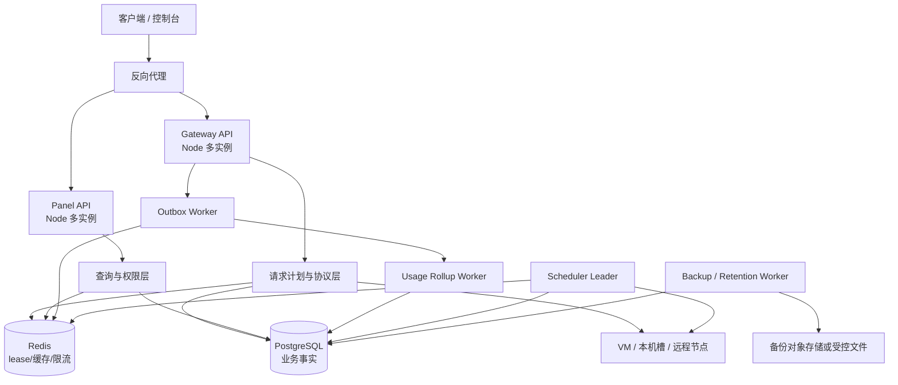
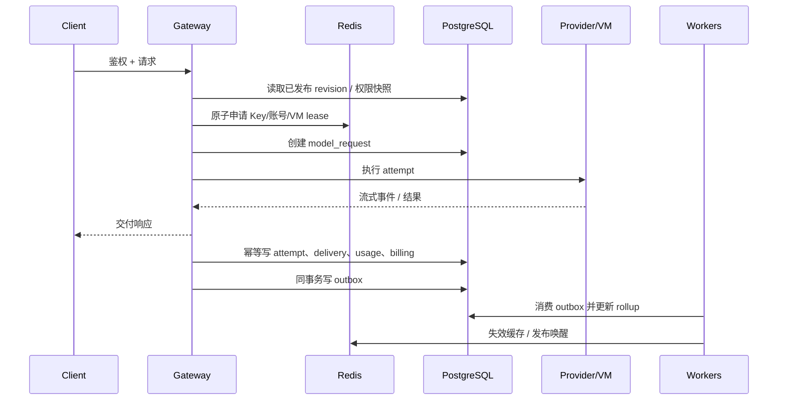

# vm2api 新业务与数据架构（PostgreSQL + Redis）

状态：目标架构设计，尚未切换生产数据库。

日期：2026-11-02

本文把当前 vm2api 与本机两套参考系统的业务、数据和运行处理方案合并为一套可落地的 vm2api 目标架构。它描述迁移后的事实来源、请求生命周期、调度和统计边界，不授权生产数据库迁移、部署或删除现有 SQLite 数据。

## 1. 研究基线和取舍

本轮对照了以下源码快照：

| 系统 | 快照 | 本轮重点 |
| --- | --- | --- |
| 定制 NewAPI（本机 `sub2api`） | `NewAPI@e49c878aaabe5bacdd8dceb8b996480c6c3e19a5` | Go + Ent + PostgreSQL、Redis 限流/缓存、scheduler outbox、usage billing events、按日用量汇总、运营/支付/供应商业务 |
| codex-proxy-rs | `main@e0b7a841ca074f17e11dad73f39a159c75cb2fb1` | Core/Store/API/Admin 分层、`model_requests` 请求事实、Redis lease、PostgreSQL analytics facts/15 分钟投影、运行 revision 和配置快照 |
| vm2api | `main@99cf1eec924f6746ee331318716e73c55d8eb1ad` | Node 控制面、SQLite `DatabaseSync`、VM/节点/代理运行时、Claude/OpenAI 协议和供应商平台 |

### 1.1 直接吸收

- PostgreSQL 保存业务事实，Redis 只保存可过期、可重建的协调状态、缓存和限流状态。
- 请求只有一条权威主记录；重试、换号和故障转移属于该请求的 attempt 事实，不建立第二份账本。
- 请求开始时冻结权限、模型、供应商候选、价格和调度配置的 revision，运行中不反复读取可变配置。
- 账单事件、缓存失效、调度唤醒通过 PostgreSQL outbox，消费者可以重试并保持幂等。
- 明细查询和统计投影分离；统计页读取汇总表或投影，不扫描全部原始请求日志。
- 配额、并发和账号状态采用 lease/CAS/幂等操作，允许多实例但不依赖某个 Node 进程的内存。

### 1.2 只改造采用

- CPR 的 Core/Store/API/Admin 责任边界用于 vm2api 的模块边界，但保留 vm2api 的 Node 协议入口、Go worker、VM/容器/SSH 节点和供应商领域。
- CPR 的 `request_observation_json` 适合作为受约束的诊断扩展，但 vm2api 的高频筛选字段仍保留为 PostgreSQL 普通列，避免所有控制台查询依赖 JSONB 表达式。
- NewAPI 的 Ent/Go 代码生成模式不直接移植到 Node；vm2api 使用 SQL migration + typed repository/service facade，避免把当前业务重新绑定到 Go ORM。
- NewAPI 的支付、钱包、供应商层次只吸收事务、幂等和 outbox 处理方式，不改变 vm2api 已确认的供应商、分组、结算和权限合同。

### 1.3 明确排除

- 不把 Redis 作为余额、账单、结算或权限的唯一来源。
- 不直接使用 PM2 `-i max` 复制当前 Node 进程；现有 scheduler、VM 操作和进程内缓存必须先外置或选出唯一 leader。
- 不把 VM 凭据、原始 prompt、完整 debug 响应放入 Redis。
- 不一次性把 SQLite 表原样搬到 PostgreSQL 后继续使用原来的全表统计查询。

## 2. 目标运行拓扑



第一阶段不必拆成很多仓库。可以先保持一个代码仓库和一个组合入口，但把进程职责分开：

| 进程 | 责任 | 是否允许多实例 |
| --- | --- | --- |
| Gateway API | 鉴权、请求计划、协议转换、流式交付 | 允许 |
| Panel API | 控制台查询和管理 mutation | 允许 |
| Scheduler | 账号、VM、代理、健康探测和恢复 | 仅一个 active leader，另有 standby |
| Outbox Worker | 调度唤醒、缓存失效、usage/billing 事件 | 允许，按租约消费 |
| Rollup Worker | 统计 facts、15 分钟/日汇总和 retention | 允许，按分片或租约消费 |
| Backup Worker | 数据库备份、恢复前检查和保留策略 | 仅一个 active leader |

## 3. 数据所有权

### 3.1 PostgreSQL：不可丢失的业务事实

建议的核心表如下：

| 领域 | 表 | 关键规则 |
| --- | --- | --- |
| 身份与权限 | `users`、`panel_users`、`api_keys`、`groups`、`group_resources`、`vendor_*` | 权限、归属和资源范围必须由事务提交；不从 Redis 推导授权 |
| VM/节点/代理 | `vms`、`cluster_nodes`、`proxies`、`vm_proxy_bindings`、`runtime_states` | 文件/容器运行状态是外部投影；数据库保存期望状态、归属、版本和最后观测 |
| 配置发布 | `settings`、`config_revisions`、`runtime_snapshots` | mutation 在一个事务内写业务事实、审计和 revision；请求只使用已发布快照 |
| 请求 | `model_requests`、`request_attempts` | `model_requests.id` 是请求权威 ID；attempt 使用 `(request_id, attempt_no)` 唯一键 |
| 交付和计量 | `delivery_facts`、`usage_facts`、`billing_charges` | 发送状态、下游交付、用量和费用分别建模；费用以请求/attempt 幂等 |
| 账单事件 | `usage_billing_events`、`settlement_allocations`、`payments` | 账单事件可重试；原始请求日志清理不影响已结算账本 |
| 异步事件 | `outbox_events` | 同一业务事务内写入；消费者使用 `available_at`、租约和重试计数 |
| 统计事实 | `request_analytics_facts`、`request_analytics_15m`、`usage_group_daily_rollups` | 从明细增量投影；可重建，查询不阻塞请求写入 |
| 审计和诊断 | `audit_events`、`request_diagnostics` | 脱敏、有限大小和保留期；不把诊断字段复制成多套事实 |

请求明细建议按 `started_at` 或 `completed_at` 月分区。高频筛选字段（时间、用户、Key、分组、VM、模型、状态、费用）用普通列和复合索引；扩展诊断使用受约束的 `jsonb`，并限制大小。

### 3.2 Redis：运行态和加速层

Redis 保存以下可重建状态：

- API Key、用户和配置快照的短 TTL 缓存；
- client/API Key、账号、VM 的并发 lease 和续期 token；
- cooldown、circuit、失败轮次和短期账号亲和；
- RPM/频率限制计数；
- scheduler 唤醒队列、短期等待队列和 worker 心跳；
- dashboard、统计和模型目录缓存；
- 登录 session 和一次性授权状态。

每个 lease 必须包含资源 ID、请求 ID、持有者 token、代次和过期时间。释放必须校验 token/代次，不能用普通 `DEL` 删除别的请求的租约。Redis 故障时，不能继续接受需要严格配额或并发裁决的新请求；已开始的流式请求按既有清理和超时策略结束。

## 4. 请求业务生命周期



请求开始时一次性冻结：

- 身份、Key、用户、分组和供应商资源范围；
- 请求模型、上游模型、协议和客户端能力；
- 价格 revision、服务档位和计费规则；
- 候选账号/VM、代理绑定和调度策略；
- 请求级重试预算、并发池和截止时间；
- 当前业务时间解释和 UTC+8 日期边界。

运行中不重新读取可变分组关系或价格。配置变化只影响新请求；正在运行的请求继续使用自己的 snapshot。

一个客户端请求只产生一条 `model_requests`。每次换号、重试、fallback 或 provider transport 尝试写入 `request_attempts`。`not_sent`、`sent`、`ambiguous` 是单调发送事实；下游第一次不可撤回交付后禁止不安全重试。

响应结束、客户端断连、取消、上游失败和进程退出都进入同一个 finalizer：

1. 固定最终 outcome、delivery commit、usage evidence 和费用来源；
2. 使用唯一键写入 billing charge，重复 finalizer 返回已存在结果；
3. 释放 Redis lease；
4. 写入 outbox，异步更新统计、缓存和通知。

流式响应不等待统计投影完成。账单写入失败时，必须保留 `usage_billing_events` 并重试；不能因为控制台统计暂时落后而丢失费用。

## 5. 调度、并发和账号状态

调度分成三层：

1. **PostgreSQL 事实层**：账号是否启用、凭据版本、代理绑定、配额快照、策略 revision、VM 归属。
2. **Redis 运行层**：当前并发 lease、冷却、短期失败计数、会话亲和和等待位置。
3. **Scheduler 投影层**：根据两者计算候选和 admission reason，不把历史 usage 日志当作实时并发计数。

账号选择前冻结候选集合，使用 Redis 原子 lease 申请容量；续期失败或代次不匹配时取消当前执行。调度器对 VM、代理、节点和账号操作使用 PostgreSQL 任务记录加 Redis worker lease，所有命令都带幂等操作 ID。

账号错误保护、provider cooldown、proxy unavailable 和 VM offline 必须分开存储，最后通过统一 projection 对外展示。一次错误不能同时修改多个独立状态，迟到结果也不能清除较新的冻结代次。

## 6. 计量、账单和供应商结算

计量和观测分离：

- `model_requests` 保存请求生命周期和关键查询字段；
- `request_diagnostics` 保存有限大小的阶段耗时、传输和失败摘要；
- `usage_facts` 保存 token、图片、搜索、缓存和费用证据；
- `billing_charges` 保存最终应计费用和价格 revision；
- `vendor_usage_facts` 保存供应商归属、合同版本和分成快照；
- `settlement_allocations` 把已结算用量与结算单绑定。

费用必须使用请求开始时冻结的价格和分组倍率。未知费用保持 `NULL`/`unknown`，不能用零覆盖未知事实；只有明确的免费或无用量结果才能计为零。

账单事件状态建议为：

```text
pending -> pricing -> settled -> applied
                    \\-> failed -> retry
```

同一请求、Key、operation 或批次的唯一约束必须在 PostgreSQL 中表达。供应商结算读取已冻结的 usage snapshot，不直接依赖当前账号、当前价格或当前分组配置。

## 7. 统计和控制台查询

控制台不能直接对 `usage_logs`/`model_requests` 做全历史聚合。采用两级投影：

1. `request_analytics_facts`：窄字段、可分页、可按请求或账号重建；
2. `request_analytics_15m`、小时、日汇总：按模型、Key、用户、VM、分组和供应商维度保存计数、token、费用、延迟和分布。

请求写入通过 outbox 或 pending projection 标记待处理项。Rollup Worker 使用 `FOR UPDATE SKIP LOCKED` 分批领取，记录 generation、coverage_start/end 和 oldest_pending_at。控制台返回 `as_of`、coverage 和 pending 状态，不能把尚未投影的数据伪装成完整统计。

控制台读取顺序：

```text
Redis 短缓存 -> PostgreSQL rollup -> PostgreSQL 窄事实 -> 原始明细（仅详情/审计）
```

统计缓存按用户/供应商 scope、时区、时间范围、维度和配置 generation 分片。当前 vm2api 的 UTC+8 业务日、当日截止时间、历史账单快照和供应商权限继续保持；rollup 以 UTC 存储桶，再按业务时区投影日期。

## 8. 配置发布和缓存失效

管理 mutation 的事务顺序固定为：

```text
校验当前 revision
  -> 写业务事实
  -> 写 audit event
  -> 推进 config revision
  -> 写 outbox/cache invalidation
  -> commit
```

Redis Pub/Sub 只用于缩短收敛时间，不能作为唯一失效通知。Worker 重启后从 outbox 和 PostgreSQL revision 对账，能够补发遗漏的失效。缓存键不包含原始凭据，授权缓存使用 hash/fingerprint。

请求计划使用 immutable snapshot；新增配置在发布成功前不进入 Gateway。发布失败时保留旧 snapshot 和旧 revision。

## 9. 故障、恢复和降级

| 故障 | 处理 |
| --- | --- |
| Redis 不可用 | 停止需要严格 lease/限流的新请求；允许明确不依赖 Redis 的健康和只读页面短暂降级；不丢 PostgreSQL 账单 |
| PostgreSQL 不可用 | 拒绝新的需要鉴权、配额或计费的请求；已建立的流尽量完成，但 finalizer 必须保留本地待重试状态 |
| Rollup Worker 停止 | 原始请求和账单继续写入；控制台显示统计滞后，不阻断推理 |
| Outbox Worker 停止 | 事务事实仍可提交；缓存和通知延迟；恢复后按 `available_at` 重试 |
| Gateway 进程崩溃 | Redis lease TTL 回收运行名额；PostgreSQL stale request recovery 处理未终结请求 |
| Scheduler leader 崩溃 | standby 取得 leader lease；所有外部 VM/代理命令按 operation ID 幂等恢复 |
| 统计投影出错 | 保留 pending/bad 状态和错误原因；不删除源事实；支持按时间桶或请求重建 |

备份至少包括 PostgreSQL schema、业务表、账单事件、outbox、rollup 状态和 VM/代理元数据。Redis 不作为备份恢复依据，只恢复可重建状态和缓存。

## 10. 从当前 SQLite 的迁移路线

### Phase 0：边界和对照

- 固定 SQLite 当前 schema、数据量、账单总额、usage 总量和供应商结算快照。
- 给现有 repository 增加 `RequestFacts`、`AttemptFacts`、`BillingFacts`、`RuntimeSnapshot` facade，但不改变 HTTP 契约。
- 为每个迁移批次保留 SQLite 外部备份和可恢复校验记录。

### Phase 1：PostgreSQL 旁路读取

- 建立 PostgreSQL schema、分区、索引、migration checksum 和连接池。
- 导入用户、Key、分组、VM、代理、账号、usage、账单和供应商数据。
- 用离线对照检查行数、金额、token、按 UTC+8 的每日汇总和结算边界。

### Phase 2：先切控制面查询

- 控制台统计先读 PostgreSQL rollup；原始日志详情仍读 SQLite。
- 建立短缓存、查询超时、连接池隔离和 `as_of/coverage` 返回字段。
- 只在对照结果稳定后切换全部 panel query。

### Phase 3：切新请求写入

- 新请求写 PostgreSQL `model_requests`、attempt、usage 和 billing events。
- SQLite 进入只读兼容期；禁止两边各自计算账单。
- Outbox、Rollup、Scheduler 和 stale request recovery 在隔离环境压测。

### Phase 4：切 VM/供应商运行事实

- VM、节点、代理、账号、供应商资源和权限 mutation 切 PostgreSQL。
- 文件、容器、远程节点仍作为 runtime adapter，不直接成为业务事实。
- 完成多进程重复 scheduler、CAS、租约丢失、重启和回滚测试。

### Phase 5：封存 SQLite

- 停止 SQLite 写入，保留只读导出和可验证备份。
- 删除旧读取路径前，搜索所有旧表、旧字段、旧 JSON 文件和迁移入口。
- 生产数据库迁移、切换和历史数据处置需要单独授权，不能由本设计文档自动执行。

## 11. 第一批实施范围

第一批不直接改数据库，先实现以下代码边界：

1. `request-facts`、`attempt-facts`、`delivery-commit`、`billing-facts` 类型和 finalizer facade；
2. `RuntimeSnapshot`、config revision 和发布/失效 facade；
3. PostgreSQL repository interface 与 SQLite adapter 并存；
4. Redis lease/cache interface，先用内存或 SQLite adapter 做单进程回归；
5. panel query facade 与 rollup 查询 DTO；
6. outbox、pending projection、worker lease 的隔离单测和真实 SQLite 回归；
7. 新旧查询结果对照工具，覆盖权限、费用、UTC+8、供应商 scope 和结算范围。

完成这些边界后，才进入 PostgreSQL/Redis 实例接入和数据迁移。第一批的验收标准是业务语义和幂等边界稳定，不以“已经接入 PostgreSQL”作为完成标准。

## 12. 研究证据索引

### 定制 NewAPI

- `backend/cmd/server/application.go`：HTTP 生命周期、排空和请求/连接 owner。
- `backend/internal/server/router.go`：Redis 限流器、缓存和服务组合方式。
- `backend/internal/service/usage_record_worker_pool.go`：usage 异步记录 worker。
- `backend/internal/repository/gateway_cache_claude_state.go`：Redis Lua 原子缓存、TTL 和容量回收。
- `backend/migrations/036_scheduler_outbox.sql`、`152_scheduler_outbox_dedup_key.sql`：调度 outbox 和幂等键。
- `backend/migrations/184_auth_cache_invalidation_outbox.sql`：数据库触发器生成授权缓存失效事件。
- `backend/migrations/222_group_usage_daily_rollups.sql`、`223_group_usage_rollup_timezone.sql`：按业务时区的日汇总和发布水位。
- `backend/migrations/281_usage_billing_events.sql` 及 `298`–`304`：可重试 usage/billing 事件、证据、意图和 canonical binding。

### codex-proxy-rs

- `docs/architecture.md`：Core/Store/API/Admin 边界、PostgreSQL/Redis 所有权、请求生命周期、lease、账单和 analytics。
- `backend/migrations/0001_initial.sql`：管理员、Client Key、运行设置、Provider 账号和分组基础模型。
- `backend/migrations/0002_client_key_budgets.sql`：Key 预算窗口和费用事件。
- `backend/migrations/0008_concurrency_queues.sql`：并发等待和容量策略。
- `backend/migrations/0025_request_observation.sql`、`0027_request_observation_projection.sql`：请求观测约束和投影。
- `backend/migrations/0029_usage_indexes_and_identity_snapshots.sql`、`0030_analytics_and_scheduling.sql`：交付请求索引、统计事实、增量构建游标和调度索引。
- `backend/migrations/0032_usage_and_scheduling.sql`：pending request、增量统计维护和历史保留。
- `backend/crates/gateway-store/src/postgres/observability/analytics/`：analytics worker、facts、15 分钟桶、覆盖水位和查询。
- `backend/crates/gateway-store/src/workers.rs`：请求 analytics 和 worker lease 的监督执行。

### vm2api 当前实现

- `src/lib/db/database.mjs`：当前 `node:sqlite` `DatabaseSync` 单进程数据库层。
- `src/lib/admin/request-log.mjs`：请求完成同步写 usage summary 和 debug 记录。
- `src/lib/db/repos/statistics-repo.mjs`、`src/lib/db/repos/usage-logs-view.mjs`：当前控制台统计和日志查询路径。
- `src/server.mjs`：Node HTTP 入口、scheduler 初始化、VM/节点/代理和控制台组合根。
- `docs/RELAY_OPERATIONS.md`、`docs/supplier-platform/`：现有分组、供应商、权限、计费和结算契约。
- `docs/cpr/`：vm2api 已有 CPR 研究和 Codex 调度事实层资料；本文件补充 PostgreSQL/Redis、NewAPI 对照和目标数据架构。
