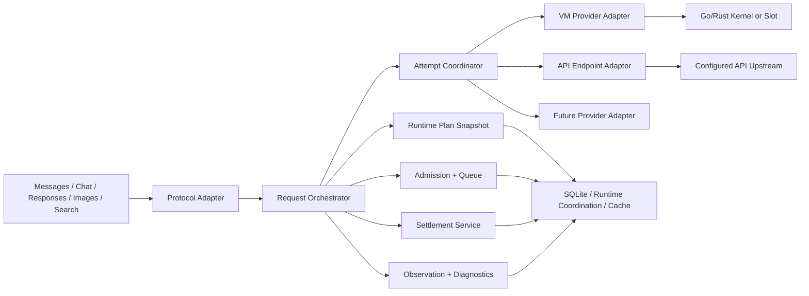

# CPR 方案在 tapmodels 中的目标架构与契约

本文把 [研究结论](01-research.md) 转化为 tapmodels 的目标工程设计。它描述边界、事实和不变量，不等于已经存在的接口或数据库表。

## 目标

在保留 VM、节点、供应商和商业运营模型的前提下，建立一条跨 Anthropic/OpenAI、VM/API endpoint 和本地/远程节点一致的请求执行骨架：

```text
协议入口
  -> 认证与权限快照
  -> RequestPlanSnapshot
  -> 客户/用户/分组准入
  -> 资源等待与 lease
  -> Provider/VM attempt
  -> 发送状态与下游交付
  -> 幂等结算
  -> 观测和诊断
```

## 目标模块



建议的职责归属：

| 模块 | 负责 | 不负责 |
| --- | --- | --- |
| Protocol Adapter | 解析、校验、协议转换、响应投影 | 决定换号、计费和账号保护 |
| Request Orchestrator | 创建 request、冻结 snapshot、串接生命周期 | 解释 Provider 私有正文 |
| Runtime Plan Snapshot | 保存请求期权限、模型、资源、策略、价格和 revision | 保存完整正文或连接句柄 |
| Admission + Queue | Key/用户/分组准入、RPM、并发、等待位置、lease | 选择 Provider 私有重试策略 |
| Attempt Coordinator | 每次资源尝试、发送状态、恢复预算、交付提交 | 重新解释协议字段 |
| Provider Adapter | 凭据、上游地址、协议 transport、Provider 用量和错误事实 | 跨 Provider fallback 和客户账本 |
| Settlement Service | 费用来源、价格快照、幂等入账和余额/额度变更 | 生成调度资格或诊断文本 |
| Observation/Diagnostics | 有界事实、trace、脱敏、导出和完整性状态 | 改变客户端响应或重试资格 |
| Store/Runtime Coordination | 业务事实、租约、短期协调状态 | 解释业务策略 |

## RequestPlanSnapshot

请求开始时创建一次，建议字段如下：

```text
request_id
config_revision
protocol
operation
client_key_id
user_id
group_ids
allowed_resource_ids
allowed_models
requested_model
resolved_model
capabilities
provider_candidates
account_or_vm_scope
retry_policy
max_attempts
max_account_switches
deadline_at
pricing_revision
account_protection_revision
risk_policy_revision
session_affinity
```

快照规则：

- 快照只保存权限、策略和资源引用，不复制请求正文
- 请求执行期间不重新读取 Key 分组、用户状态、模型白名单和价格覆盖
- 配置修改影响新请求；已有请求持有旧快照直到终态
- WebSocket 连接和 `response.create` 轮次分别持有连接事实与请求快照
- 快照编译失败时停止新请求或保留上一个已确认快照，不能发布半成品

## Request / Attempt 状态机

### 请求状态

```text
received
  -> authenticated
  -> planned
  -> queued
  -> admitted
  -> executing
  -> downstream_committed
  -> finalizing
  -> finalized
```

终止分支：

```text
authenticated -> rejected
planned       -> rejected
queued        -> queue_timeout | cancelled
admitted      -> cancelled | admission_lost
executing     -> failed | cancelled | incomplete
```

### Attempt 状态

```text
selected
  -> prepared
  -> not_sent
  -> sent
  -> ambiguous
  -> response_started
  -> response_committed
  -> completed | failed | cancelled
```

不变量：

1. `send_state` 只允许向更高风险方向推进，不能从 `ambiguous` 回退到 `not_sent`
2. `downstream_committed=true` 后，不能换号、重放、fallback 或修改 HTTP 状态
3. attempt 失败不自动创建新的 request；新的 attempt 必须挂在同一个 request ID 下
4. 费用、观测和 lease 清理由同一个终态 future 或 detached finalizer 负责，取消等待不能重复创建清理任务
5. Provider 可以声明恢复意图，Core 必须再次检查 deadline、取消、发送状态、副作用和剩余预算

## Admission、Queue 和 Lease

建议分三层：

| 层 | 事实 | 失效方式 |
| --- | --- | --- |
| 业务准入 | 用户、Key、分组、余额、套餐、RPM | 数据库事务或内存快照 |
| 等待位置 | 当前进程 FIFO/优先级队列 | 取消、超时、进程重启 |
| 运行 lease | 节点运行时或未来引入的共享协调存储中的并发和资源占用 | 显式释放、TTL、启动恢复 |

请求 deadline、队列等待预算、lease TTL、Provider 连接空闲超时和单次 attempt 超时必须分开保存。TTL 只保证资源约束不会永久泄漏，不能拿来当作模型执行的总时限。

队列应返回明确原因：

- `key_rate_limited`
- `user_rate_limited`
- `group_rate_limited`
- `concurrency_limited`
- `resource_busy`
- `quota_exhausted`
- `account_error_protected`
- `policy_filtered`
- `queue_full`
- `queue_timeout`

## Continuation 与 Sticky

建议把现有 sticky/session/previous-response 事实统一成一套 `ContinuationBinding`：

```text
client_key_id
provider
resource_id
account_id / vm_id
session_id / previous_response_id
scope
credential_revision
bound_at
expires_at
```

规则：

- continuation 必须匹配 Client Key 和授权分组
- Provider/账号绑定不可由普通 fallback 改写
- opaque response ID 不由 Core 按前缀、长度或格式解释
- 绑定存储不可用时，不能把原始 ID 直接转发到未知账号
- 连接级 continuation 只能由实际持有连接的 transport 恢复
- 绑定失效要返回明确的 `continuation_recovery_required` 或 `continuation_scope_unavailable`

## Settlement Ledger

建议新增独立结算事实，先不改变现有 `usage_logs` 的查询接口：

```text
settlement_events
  id
  request_id
  attempt_id
  client_key_id
  user_id
  group_id
  resource_id
  provider
  model
  usage_json
  provider_cost
  calculated_cost
  final_cost
  cost_source
  price_revision
  multiplier_revision
  status
  idempotency_key
  created_at
  finalized_at
```

写入要求：

- `idempotency_key` 唯一，重复终态只能返回原结算结果
- Provider 报价、网关估算和不可用必须保留来源，不能把未知费用静默写成零
- 价格修改只影响新请求；历史事件使用保存的价格 revision
- 日志删除、统计重建和诊断导出不能删除或改变结算事件
- 余额、套餐或 Key 额度的变化必须和结算事件关联，失败时保留可重试状态

## Account Error Protection

建议策略模型：

```json
{
  "enabled": true,
  "threshold": 12,
  "windowSeconds": 600,
  "durationSeconds": 7200,
  "probeEnabled": true,
  "probeModel": null,
  "rules": [
    {
      "id": "provider-auth-expired",
      "name": "凭据持续失效",
      "conditions": [
        {"field": "provider", "operator": "equals", "values": ["anthropic"]},
        {"field": "status", "operator": "equals", "values": ["401"]}
      ]
    }
  ]
}
```

实现边界：

- Provider 只提交结构化 `ErrorFacts`
- Core 编译并匹配规则，生成策略 fingerprint
- 运行时计数按资源、credential revision、policy revision 隔离；当前实现可先使用节点/进程协调状态，未来需要跨控制面副本时再引入共享存储
- PostgreSQL/SQLite 保存规则、冻结原因摘要和审计，不保存原始错误正文
- 恢复 Worker 使用冻结代次和当前 credential revision 做 CAS
- 错误保护不修改 VM 的真实额度，不自动修改客户 Key 余额，不替代 transport circuit

## Observation 与 Diagnostics

建议把现有 request log 扩展为三个投影：

1. **业务请求事实**：请求、终态、状态码、模型、客户、资源和结算关联
2. **attempt 事实**：资源、账号、上游 ID、发送状态、等待时间、重试原因和结果
3. **诊断证据**：有界 trace、事件类型、header 白名单、body fingerprint、丢失计数和导出可用性

证据规则：

- 默认不保存完整请求/响应正文
- 未知 JSON 键保存哈希和类型摘要，不因字段名叫 `headers` 就信任它
- Authorization、Cookie、token、password、secret 永远脱敏
- 完整请求转储必须独立开关、独立目录、独立保留期
- 诊断导出要写 `availability.gaps`、`exportTruncated`、`attemptsComplete`
- 观测写入失败不改变客户端响应，但必须进入健康指标和告警

## Runtime Config Revision

现有 `settings` 表可以先增加一条系统事实：

```text
runtime_config_revision = monotonically increasing integer
```

随后把会影响路由、权限、费用或安全的管理写入统一为：

```text
validate input
  -> read expected revision
  -> transaction writes business fact + revision + audit
  -> publish runtime snapshot
  -> notify local/remote schedulers
```

代理、VM、节点、测试计划等资源继续使用自己的 revision；不能把所有资源都塞进一个大锁。

## 现有代码落点

| 目标能力 | 首批建议接入位置 |
| --- | --- |
| RequestPlanSnapshot | `src/server.mjs`、`src/lib/core/config.mjs`、`src/lib/admin/routing-runtime.mjs` |
| AttemptCoordinator | `src/lib/pool/failover-runner.mjs`、`src/lib/transport/go-worker-client.mjs`、`src/lib/db/repos/request-attempts-repo.mjs` |
| Admission/Queue | `src/lib/pool/pool-scheduler.mjs`、`src/lib/pool/api-scheduler.mjs`、`src/lib/pool/session-limit.mjs`、`src/lib/pool/rate-limit-service.mjs` |
| Error Protection | `src/lib/pool/unit-circuit.mjs`、`src/lib/pool/upstream-error-policy.mjs`、`src/lib/admin/health-probe.mjs` |
| Observation | `src/lib/admin/request-log.mjs`、`src/lib/db/repos/request-attempts-repo.mjs`、`src/lib/db/repos/usage-logs-repo.mjs` |
| Settlement | `src/lib/admin/relay-billing.mjs`、`src/lib/admin/pricing.mjs`、新增 settlement repository |
| Model catalog | `src/lib/protocol/*catalog*`、`src/lib/admin/price-catalog.mjs`、`src/lib/pool/api-scheduler.mjs` |
| Config revision | `src/lib/db/repos/settings-repo.mjs`、相关 panel mutation 路由和审计 |

## 迁移原则

- 不改写已应用迁移；新增表和字段使用正向迁移
- 先双写或旁路记录，再把查询切换到新事实
- 新结算事件不能回填历史为“已确认”；历史记录标记来源和精度
- 新快照不可用时保留旧已确认快照；无法确认权限或安全策略时拒绝新请求
- 每个阶段保留旧路径的删除条件，避免长期双轨
