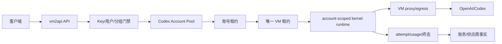

# 单一 Codex VM 多 OAuth 账号

## PRD、产品原型与技术实现方案

版本：1.0
日期：2026-11-01（Asia/Shanghai）
状态：开发前设计，尚未实现、迁移、部署或真实付费验收

本文定义在当前 vm2api 项目内实现以下能力的产品契约：**只运行一个 Codex VM/执行器，控制面可以添加多个 Codex/ChatGPT OAuth 账号，由账号调度器选择账号，所有请求都经过这个 Codex VM 转发到 OpenAI/Codex 上游。**

本文不引入独立 NewAPI 控制面、Gateway Worker、Fleet 或多 VM 集群。后续如果扩展到多执行器，应以本文的账号/执行器边界为基础，而不是重新把账号绑定回 VM。

## 1. 产品结论

### 1.1 目标形态

```text
客户端 / Codex CLI / OpenAI 兼容客户端
                    |
                    v
             vm2api 控制面
       Key / 分组 / 权限 / 计费 / 调度
                    |
       选中 account_id + lease + credential_revision
                    |
                    v
             唯一 Codex VM/执行器
       VM proxy/egress + 控制面 kernel 子进程
                    |
                    v
             OpenAI / Codex 上游
```

一个 Codex 账号是一个独立的业务资源；Codex VM 是一个执行器资源。账号保存 OAuth、账号身份、额度、RPM、并发、健康和分组授权。VM 保存运行环境、代理/出口、总并发容量和 kernel 运行状态。

用户请求只选择模型和协议，不能选择 VM、账号、kernel 进程或代理。控制面在请求准入时先选账号，再把请求派发到唯一 Codex VM。

### 1.2 本期必须满足

1. 一个 Codex VM 可承载多个 Codex/ChatGPT OAuth 账号，默认目标至少支持 10 个账号，实际上限由内存、连接数和配置决定。
2. 每个账号拥有独立的 access token、refresh token、ChatGPT account ID、credential revision、额度窗口、RPM、并发、健康和错误保护状态。
3. 同一个 VM 具有独立的总并发上限；账号并发上限和 VM 总并发上限分别生效。
4. 账号暂停、过期、429、额度耗尽或凭据刷新失败，只影响该账号，不把整个 VM 标记为不可用。
5. Responses、Chat Completions、Completions、Images、Search、HTTP/SSE 和 WebSocket 使用同一套账号选择和租约语义。
6. 会话亲和可以优先同一账号，但不能绕过账号资格、额度、保护和请求 owner 约束。
7. `previous_response_id` 续写必须绑定账号身份和 credential revision；账号被替换后不能随机换号续写。
8. 失败重试遵循现有 attempt/send-state 规则；请求已经发送或客户端已经收到业务输出后，不因为 VM 相同就跨账号重放。
9. 用量、账务、供应商归属按账号事实记录；同一请求最多一次客户扣费。
10. 控制面重启后，账号、VM 绑定、额度、保护、响应 owner 和请求事实可恢复。

唯一执行器由 `routing.codex.executor_vm_id`（或等价的持久化设置）明确指定。账号创建、激活和调度只能使用该 VM；尝试激活第二个 Codex VM 必须返回 `single_codex_executor_required`，不能静默形成第二个账号池。切换执行器属于受控迁移，必须先排空在途请求、处理响应 owner、冻结新准入，再执行 CAS 切换。

### 1.3 明确不做

- 本期不支持多 Codex VM 组成账号池。
- 本期不支持一个账号同时绑定多个 VM。
- 本期不支持隐式激活第二个 Codex VM；第二个 VM 只能作为未来迁移候选或已排空的备用资源存在。
- 本期不支持用户在请求中指定账号或 VM。
- 本期不把多个账号写入一个凭据文件后由 kernel 自己轮换。
- 本期不让 kernel 自己决定账号、分组、价格、账务或客户 Key。
- 本期不引入 NewAPI/Gateway Worker 独立控制面。
- 本期不实现跨控制面 active-active、跨主机调度或无损流中迁移。
- 本期不承诺真实上游 OAuth、生产代理和付费推理已经验收；这些属于后续环境验收。

## 2. 现状差距与设计原则

当前实现把 Codex VM 当作账号单位：凭据文件固定在 `vms/<vmId>/codex-credentials.json`，导入路径更新 `accounts[0]`，候选 ID 使用 `vm.id`，kernel supervisor 以 `vmId` 管理一个进程和一个 socket，attempt/response owner/额度/保护也以 VM 为主键。该行为不能通过继续扩展 `accounts` 数组解决，因为调度、刷新、额度和续写仍会读第一项。

当前源码核对入口：

| 事实 | 入口 | 设计影响 |
| --- | --- | --- |
| Codex 凭据路径和读取 | `src/lib/vm/codex-slot.mjs` | 必须迁移到账号级 credential path |
| Codex 导入覆盖第一账号 | `src/lib/admin/panel-routes.mjs`、`panel-vm-import-routes.mjs` | 新导入不能再写回 VM 第一项 |
| 账号候选和容量 | `src/lib/pool/codex-slot-pool.mjs` | 候选主键改为 account，VM 增加总容量 |
| 请求 attempt、owner、Search/Images | `src/lib/protocol/handle-codex.mjs` | 所有辅助路径都要携带 account context |
| kernel 配置和进程生命周期 | `src/lib/transport/codex-kernel-supervisor.mjs`、`codex-kernel-client.mjs` | supervisor key 改为 runtimeId |
| VM 摘要、额度和资格 | `src/lib/vm/vm-registry.mjs` | VM 只保留执行器摘要，账号成为真相 |
| placement 和远程 socket | `src/lib/cluster/placement.mjs` | account runtime 必须支持本机和远程槽 |

本需求采用以下原则：

1. `account_id` 是业务账号、额度、并发、RPM、保护、会话、attempt 和账务单位。
2. `executor_vm_id` 是运行位置、代理和总容量单位，不拥有账号身份。
3. 控制面先选账号，再解析到唯一 VM；kernel 只执行已经选择的账号。
4. 不在普通请求 envelope 中携带长期 access/refresh token。
5. 方案 A 先使用每账号独立 kernel runtime；方案 B 的单 kernel 多账号协议另行评审。
6. unknown、partial、ambiguous 和 explicit zero 继续保持不同语义。
7. 现有 Claude VM、API endpoint、商业分组、Key 和账务边界保持不变。
8. 代码、迁移、真实 OAuth、生产部署和付费验收分别报告，不把设计状态写成已实现。

## 3. 角色和产品交互

### 3.1 Codex 账号池列表

```text
┌──────────────────────────────────────────────────────────────┐
│ Codex 账号池                              [添加 OAuth 账号]   │
├──────────────────────────────────────────────────────────────┤
│ 执行器 codex-vm-01  ● Ready   总并发 4 / 20   排队 2          │
│ 账号 8   可用 6   冷却 1   额度耗尽 1   凭据异常 0            │
├──────────────────────────────────────────────────────────────┤
│ 状态 ▾  分组 ▾  套餐 ▾ 额度 ▾ 最近错误 ▾ 搜索邮箱/账号 ID    │
├──────┬────────┬────────┬────────┬────────┬────────┬──────────┤
│ 账号 │ 状态   │ 额度   │ 容量   │ 调度   │ 最近活动│ 操作     │
├──────┼────────┼────────┼────────┼────────┼────────┼──────────┤
│ ...  │ Ready  │ 5H/7D  │ 1/2    │ w=1    │ 2m ago │ 详情 ... │
└──────┴────────┴────────┴────────┴────────┴────────┴──────────┘
```

列表必须区分“没有账号”“有账号但全部不可用”“VM 离线”“查询失败”和“加载中”。未知额度显示“未知”，不能显示虚构的 0。

### 3.2 添加 OAuth Dialog

步骤固定为：平台与认证 → 代理与授权 → 凭据验证 → 分组与策略 → 提交摘要。

```text
账号：alice@example.com
平台：OpenAI / Codex OAuth
执行器：codex-vm-01（固定）
分组：Coding Pro、Internal GPT
并发：默认 2     RPM：默认     权重：1
状态：credential_verified / executor_unavailable

[取消] [保存并启用]
```

交互规则：

- 草稿有效期 30 分钟；关闭窗口保留草稿。
- OAuth 成功但 VM 离线可以保存为 `executor_unavailable`，不能显示为凭据错误。
- 提交前重读权限、分组版本、执行器状态和幂等键。
- 失败保留输入和草稿，重复提交返回原资源。
- 供应商不能提交 `executor_vm_id`、Server、Fleet、owner、VM 参数或成本字段。

### 3.3 账号详情抽屉

区域：身份、运行、额度、调度、用量、事件。展示保存名称、邮箱、脱敏 ChatGPT account ID、套餐、credential revision、状态、5H/7D、并发/RPM、最近使用、TTFB、错误分类和 usage confidence。永不展示 token、Cookie、socket、代理密码和客户 Key。

### 3.4 唯一 Codex VM 卡片

```text
Codex 执行器
状态：Ready
绑定账号：8
总并发：4 / 20
排队：2
Kernel：0.160.x
能力：Responses · SSE · WebSocket · Images · Search
出口：proxy-tokyo · healthy

[Drain] [Resume] [修改总并发]
```

Drain 只阻止新请求进入 VM，已发送请求按现有终态规则收尾；不暂停账号、不删除凭据。

## 4. 领域模型

### 4.1 CodexAccount

建议新增 SQLite 表，账号不再以 VM JSON 作为唯一真相：

```sql
codex_accounts (
  id TEXT PRIMARY KEY,
  platform TEXT NOT NULL CHECK(platform = 'openai'),
  provider_kind TEXT NOT NULL DEFAULT 'codex_oauth',
  execution_kind TEXT NOT NULL DEFAULT 'codex_vm',
  executor_vm_id TEXT NOT NULL,
  vendor_resource_id TEXT,
  name TEXT,
  email TEXT,
  chatgpt_account_id TEXT,
  plan_type TEXT,
  credential_revision INTEGER NOT NULL DEFAULT 0,
  credential_state TEXT NOT NULL,
  schedule_state TEXT NOT NULL DEFAULT 'active',
  max_concurrency INTEGER NOT NULL DEFAULT 2,
  max_rpm INTEGER NOT NULL DEFAULT 0,
  max_sessions INTEGER NOT NULL DEFAULT 0,
  weight REAL NOT NULL DEFAULT 1,
  allowed_models_json TEXT NOT NULL DEFAULT '[]',
  created_at TEXT NOT NULL,
  updated_at TEXT NOT NULL,
  archived_at TEXT
)
```

约束：`executor_vm_id` 只能指向唯一 active Codex VM；归档账号不能被新请求选择；`chatgpt_account_id` 缺失时不猜测；权重只影响排序，不保证流量比例。

### 4.2 CodexAccountCredentials

SQLite 只保存元数据，秘密放在每账号独立文件中：

```sql
codex_account_credentials (
  account_id TEXT PRIMARY KEY REFERENCES codex_accounts(id),
  credential_revision INTEGER NOT NULL,
  credential_path TEXT NOT NULL,
  has_access INTEGER NOT NULL DEFAULT 0,
  has_refresh INTEGER NOT NULL DEFAULT 0,
  expires_at TEXT,
  token_fingerprint TEXT,
  refreshed_at TEXT,
  last_refresh_error TEXT,
  updated_at TEXT NOT NULL
)
```

文件布局建议：

```text
<data>/codex-accounts/<account_id>/credentials.json  0600
<data>/codex-accounts/<account_id>/lock             0600
<data>/codex-accounts/<account_id>/identity.json    0600
```

每个凭据文件只包含一个账号。不得继续依赖多账号数组的第一项。

### 4.3 CodexExecutorRuntime

复用 `vms/<id>.json` 作为执行器基础记录，并增加运行时投影：

```sql
codex_executor_runtime (
  vm_id TEXT PRIMARY KEY,
  max_concurrency INTEGER NOT NULL DEFAULT 20,
  active_concurrency INTEGER NOT NULL DEFAULT 0,
  queue_depth INTEGER NOT NULL DEFAULT 0,
  runtime_state TEXT NOT NULL,
  drain_requested INTEGER NOT NULL DEFAULT 0,
  kernel_capabilities_json TEXT NOT NULL DEFAULT '{}',
  proxy_revision INTEGER,
  last_health_at TEXT,
  updated_at TEXT NOT NULL
)
```

账号数、可用账号数和额度汇总是投影，不能作为账号调度真相。

### 4.4 AccountRuntime、Quota、Lease

账号运行态必须以 `account_id` 为主键，保存 RPM 桶、错误保护 generation、cooldown、最近成功/失败和延迟。额度单独保存 5H/7D、reset credits、plan、采样来源和 confidence。

```sql
codex_account_leases (
  lease_id TEXT PRIMARY KEY,
  account_id TEXT NOT NULL,
  request_id TEXT NOT NULL,
  attempt_id TEXT NOT NULL,
  credential_revision INTEGER NOT NULL,
  expires_at TEXT NOT NULL,
  released_at TEXT,
  created_at TEXT NOT NULL
)

codex_executor_leases (
  lease_id TEXT PRIMARY KEY,
  vm_id TEXT NOT NULL,
  request_id TEXT NOT NULL,
  attempt_id TEXT NOT NULL,
  expires_at TEXT NOT NULL,
  released_at TEXT,
  created_at TEXT NOT NULL
)
```

本期单控制面使用进程内原子结构配合 SQLite 过期事实；不宣称跨控制面 active-active。

### 4.5 Attempt、Usage 和 Owner

现有 request/attempt/usage 投影增加：

- `execution_kind`；
- `account_resource_id`；
- `vm_id`；
- `credential_revision`；
- `send_state`、`terminal_state`；
- `usage_confidence`；
- `response_owner_revision`。

`response_owners` 必须保存 `account_id`、`executor_vm_id`、credential identity hash、credential revision、response ID hash、Key scope hash 和过期时间。

## 5. 迁移设计

当前迁移最大编号为 075。实施前先核对实时树和上游编号，再选择下一个无冲突编号，例如 `076_codex_account_executor_split.sql` 和后续按实际需要拆分的 usage 投影迁移。

迁移步骤：

1. 创建账号、凭据元数据、执行器运行时、额度和 lease 表。
2. 读取旧 VM 的第一套 Codex 凭据，生成一个 legacy CodexAccount。
3. 将旧 `vm.codex` 的身份和额度复制为账号初始投影。
4. 保留旧文件和旧字段，直到新账号路径通过回归。
5. 新写入全部走账号 repository；旧 `vm.codex` 只作为兼容投影。
6. 历史 request/usage 不强行伪造账号 ID。
7. 失败时不删除旧凭据、不覆盖旧 VM 调度状态。

迁移只能追加，不能修改已应用历史迁移。SQLite 迁移必须在隔离副本验证旧账号数量、分组、账单和请求日志不变。

## 6. 目标架构与调度



请求顺序固定为：认证 → Key/分组/模型门禁 → 账号候选 → quota/RPM/protection/session → 账号租约 → 唯一 VM 租约 → runtime ready → kernel 发送 → attempt/usage/账务收尾。

账号租约成功但 VM 租约失败时释放账号租约并等待；不能把账号标记为凭据错误。

候选结构：

```js
{
  id: account.id,
  accountId: account.id,
  executorVmId: account.executor_vm_id,
  credentialRevision: account.credential_revision,
  weight: account.weight,
  concurrency: account.max_concurrency,
  maxRpm: account.max_rpm,
  maxSessions: account.max_sessions,
  status,
  quotaResetAt,
  quotaRemainingRank,
  inFlight,
  rpmCount,
  healthScore,
  firstOutputLatencyMs,
  groupPriority
}
```

账号必须同时满足 active、凭据可用、模型允许、额度允许、RPM/并发未满、保护未冻结、分组和 Key 仍有权限。唯一 VM 必须 ready、非 drain、代理可用且 kernel runtime 可启动。

本期 `routing.codex.executor_vm_id` 只允许一个 active VM。激活第二个 Codex VM 返回 `single_codex_executor_required`。切换执行器必须先 Drain、阻止新准入、等待在途完成或进入人工对账，再通过 CAS 切换设置。

## 7. Account-scoped kernel runtime

### 7.1 目录布局

```text
<vms>/<vm_id>/run/codex-accounts/<account_id>/<credential_revision>/
  codex-kernel.json
  codex-kernel.sock
  internal.token
  codex-installation-id
  limit-stamp
```

远程节点必须把 runtime 目录和 socket 放入当前 Codex kernel 可访问的运行域，继续遵守 `cluster/placement.mjs` 的控制面 kernel、VM socket relay 和远程槽文件边界。

### 7.2 Supervisor 设计

当前 supervisor 以 `vmId` 为 key，改为 `runtimeId = vmId:accountId:credentialRevision`：

```js
ensureCodexKernel({ vmId, accountId, credentialRevision, vm,
  credentialPath, runtimeDir, proxyUrl, proxyRequired, routing })
stopCodexKernel({ vmId, accountId, credentialRevision })
codexKernelTracked({ vmId, accountId, credentialRevision })
```

`starts`、`stops`、health、recycle、cancel、watchdog 和 limit stamp 全部使用 runtimeId。

### 7.3 Kernel 配置

```json
{
  "vm_id": "codex-vm-01",
  "account_id": "account-uuid",
  "credential_revision": 7,
  "device_id": "installation-uuid",
  "socket_path": ".../codex-kernel.sock",
  "credential_path": ".../credentials.json",
  "proxy_required": true,
  "internal_token": "runtime-local-secret",
  "max_request_bytes": 67108864
}
```

每个 kernel 只读取自己的单账号凭据。账号 A 的 socket、token 和 credential path 不能指向账号 B。

### 7.4 资源控制

- runtime 按需启动；无请求时不为所有账号预启动进程。
- 空闲 runtime 10 分钟后回收，回收前确认没有 in-flight。
- 单 VM 限制运行中 runtime 数、内存、连接数和 socket 数。
- runtime 启动失败只隔离该账号或该 runtime，不停用整个 VM。
- VM 总并发和 runtime 进程数都纳入执行器容量判断。

### 7.5 方案 B 的边界

后续单 kernel 多账号只能使用短期 `credential_handle`、签名句柄或受控本地读取，不得把长期 token 直接放进普通 envelope。方案 B 必须有独立安全评审、协议 fixture、凭据轮换和故障恢复验收。

## 8. 协议、请求、重试和续写

### 8.1 Execution Context

`createExecutionContext()` 增加 `accountId`、`credentialRevision`、`runtimeId`、`credentialPath` 和账号身份摘要。token 不进入 request log、attempt log 或 debug dump。

### 8.2 Kernel Envelope

普通 envelope 保持 body、headers、session、options 契约，只新增非秘密上下文：

```json
{
  "request_id": "uuid",
  "account_context": {
    "account_id": "uuid",
    "credential_revision": 7,
    "runtime_id": "codex-vm-01:uuid:7"
  },
  "body": { "model": "gpt-6.1-sol", "stream": true },
  "headers": { "session-id": "..." },
  "session": { "session_id": "..." }
}
```

kernel 校验 context 与自身配置一致；不一致返回 `codex_runtime_context_mismatch`。

### 8.3 Header 和上游身份

Authorization、ChatGPT account ID、originator、User-Agent 和安装身份由对应 runtime 的账号重建。客户端 Authorization 不透传。`x-codex-routing-hint` 只包含模型和 tier，不包含长期凭据。

### 8.4 重试规则

发送前的明确账号拒绝、模型不支持、runtime 未启动和代理失败可以换账号；`send_state=ambiguous` 禁止跨账号重放；已向客户端提交业务字节后不能换号、改状态或重复扣费。VM transport failure 可在同一账号、同一 credential revision 上按预算重试。

### 8.5 Response Owner 和 Sticky

Sticky 记录 `{ accountId, executorVmId, credentialRevision }`。收到 `previous_response_id` 时必须验证 response ID、Key scope、账号 active、身份 hash、revision、模型和分组授权。账号替换、归档、撤权或 revision 变化返回 409 `response_not_portable`，客户端重新提交完整历史。

## 9. OAuth、额度、Search 和 Images

### 9.1 OAuth 生命周期

```text
draft → authorizing → callback_received → credential_verified
      → account_saved → runtime_ready / executor_unavailable
```

刷新流程按账号单航班锁、代理出口、CAS revision 和身份复核执行。返回的新身份与旧 `chatgpt_account_id` 不一致时不得静默覆盖。

### 9.2 额度

quota probe、正常请求响应头、429、手动刷新和定时刷新都按 `account_id` 写入。VM 只汇总执行器状态，不再保存单一 Codex quota 真相。unknown、explicit zero、partial、complete 必须可区分。

### 9.3 Search/Images

Search 和 Images 接收选中的 account context，从账号凭据路径读取并以 `account_id` 加锁刷新；不能继续读取 VM 的 `accounts[0]`。图片部分成功、usage、模型权限和套餐限制都按账号记录。

## 10. 账务、usage 和审计

request 事实属于 Key/用户；attempt 事实同时记录 `account_id` 和 `executor_vm_id`；usage 归属账号；客户扣费仍按 request 幂等一次；供应商结算使用 account resource owner 快照。

计量置信度至少支持 `complete`、`partial`、`explicit_zero`、`unknown`、`not_applicable`。未知不能显示为零，不自动退款或补扣。重复终态只更新观察事实；迟到 usage 可以补充技术事实，但不能改写已确认价格和账单。

审计事件包括 account_created、credential_verified、credential_refreshed、credential_replaced、identity_changed、account_paused/resumed/archived、executor_drained/resumed、quota_updated、account_cooldown、response_owner_rejected 和 attempt_ambiguous。审计不记录 token、Cookie、完整正文和代理认证。

## 11. API 设计

### 11.1 执行器

```http
GET /api/panel/codex/executor
PUT /api/panel/codex/executor
POST /api/panel/codex/executor/drain
POST /api/panel/codex/executor/resume
```

返回执行器 VM ID、状态、总并发、当前并发、队列、账号数、能力和代理健康。不能通过接口激活第二个 active Codex VM。

### 11.2 账号

```http
GET /api/panel/codex/accounts
GET /api/panel/codex/accounts/:id
POST /api/panel/codex/accounts
PATCH /api/panel/codex/accounts/:id
POST /api/panel/codex/accounts/:id/pause
POST /api/panel/codex/accounts/:id/resume
POST /api/panel/codex/accounts/:id/archive
POST /api/panel/codex/accounts/:id/refresh
POST /api/panel/codex/accounts/:id/probe
```

写请求携带 `config_revision`、`credential_revision` 和账号策略；不接受 `vm_id`、`server_id`、`fleet_id`、token 原文或客户 Key 作为供应商输入。

### 11.3 OAuth 草稿

```http
POST /api/panel/codex/accounts/drafts
POST /api/panel/codex/accounts/drafts/:id/oauth/generate-auth-url
POST /api/panel/codex/accounts/drafts/:id/oauth/exchange-code
POST /api/panel/codex/accounts/drafts/:id/import
```

草稿提交使用幂等键。授权成功但数据库提交失败时，保存短期待提交凭据，不重复创建 active 账号。

### 11.4 错误码

```text
single_codex_executor_required
codex_account_not_found
codex_account_archived
codex_account_paused
codex_account_revision_conflict
codex_credential_invalid
codex_credential_identity_changed
codex_executor_unavailable
codex_executor_draining
codex_executor_capacity_full
codex_account_capacity_full
codex_response_not_portable
codex_runtime_start_failed
codex_runtime_context_mismatch
```

## 12. 代码实现拆分与清理

建议新增：

```text
src/lib/codex-account/
  codex-account-repo.mjs
  codex-credential-repo.mjs
  codex-account-runtime.mjs
  codex-account-status.mjs
  codex-account-files.mjs

src/lib/pool/
  codex-account-pool.mjs
  codex-executor-capacity.mjs
  codex-account-lease.mjs

src/lib/transport/
  codex-runtime-id.mjs
  codex-kernel-runtime-supervisor.mjs

web/src/features/codex-account/
  account-list.tsx
  account-create-dialog.tsx
  account-detail-drawer.tsx
  executor-card.tsx
  scheduling-settings.tsx
```

关键修改：

| 文件 | 方向 |
| --- | --- |
| `src/lib/vm/codex-slot.mjs` | 收敛为旧数据迁移/兼容适配，删除正式路径的 `accounts[0]` |
| `src/lib/pool/codex-slot-pool.mjs` | 候选改为 account，VM 只提供 executor capacity |
| `src/lib/protocol/handle-codex.mjs` | account context、attempt、owner、quota、Search/Images 全部按账号 |
| `src/lib/transport/codex-kernel-supervisor.mjs` | `vmId` 进程 key 改为 runtimeId |
| `src/lib/transport/codex-kernel-client.mjs` | account-scoped socket/config/credential path |
| `src/lib/transport/go-worker-client.mjs` | 传递非秘密 account context |
| `src/lib/vm/execution-context.mjs` | 加入 accountId、revision、runtimeId |
| `src/lib/vm/vm-registry.mjs` | VM 只保留执行器摘要 |
| `src/lib/oauth/openai-quota.mjs` | quota/refresh 改为账号主键和账号锁 |
| `src/lib/pool/account-error-protection.mjs` | protection 改为 account_id + credential revision |
| `src/lib/pool/sticky-router.mjs` | sticky payload 增加账号 revision |
| `src/lib/admin/panel-routes.mjs` | 账号池 CRUD、执行器 API、权限和幂等 |
| `web/src/features/vm/*` | VM 展示执行器摘要，移除单账号正式入口 |
| `web/src/features/codex-account/*` | 新账号池页面和向导 |

实现结束前必须搜索并清理：`readCodexAccounts(...)[0]`、`accountId: vm.id`、`vm.codex.email` 作为账号真相、Search/Images 按 VM 第一账号、以及旧 UI 中“一 VM 一账号”的文案和测试。兼容逻辑必须有具体调用方和移除条件。

## 13. 测试矩阵

### 13.1 单元

- 多账号创建、替换、refresh 和 token 文件权限；
- identity hash、credential revision 和单航班 refresh；
- account candidate、Smart/权重/亲和、quota/RPM/session；
- account lease、executor lease、Drain、暂停、取消和超时清理；
- 两个 runtime 的 socket、config、credential path 和 internal token 隔离；
- runtime context mismatch、启动失败和空闲回收；
- 发送不明、同账号 retry、response owner 409；
- 401/403/429/5xx 的账号隔离；
- Search/Images 使用正确账号；
- duplicate/late/partial/unknown usage 和账务幂等。

### 13.2 SQLite/HTTP

- 旧 VM 单账号迁移；
- 添加、替换、刷新、暂停、恢复、归档和重启恢复；
- 两账号和十账号列表、筛选、权限和幂等；
- 同一分组绑定多个账号但容量不复制；
- 深链伪造 account/vm/server/fleet 被拒绝；
- 供应商数据域和敏感字段裁剪；
- 同 Key Claude VM + Codex 账号池分流；
- 重复 usage 不重复扣费。

### 13.3 协议/浏览器/Linux

- Responses JSON/SSE、Chat、Completions、Images、Search；
- WS 大图像帧、拆分 UTF-8、LF/CRLF、多 `data:` 行、大流和取消；
- first-byte、idle timeout、429、403、401、socket close、代理错误；
- 账号替换后的 `previous_response_not_portable`；
- 浏览器四语、窄屏、键盘、加载、空列表、Drain/Resume；
- Linux 本机/远程 placement、代理 fail-closed、kernel restart 和备份恢复。

真实 OAuth、真实代理、真实模型和付费推理必须单独环境验收，不能用 mock 结果代替。

## 14. 分阶段路线

| 阶段 | 交付 | 退出条件 |
| --- | --- | --- |
| P0 | 契约、字段、错误码、runtimeId、状态机 | 评审确认账号与 VM 已分离 |
| P1 | 账号/凭据/额度/执行器表和旧数据迁移 | 旧数据库副本升级通过 |
| P2 | account-scoped kernel runtime、惰性启动、回收 | 两账号并发不串凭据 |
| P3 | account/executor 双租约、调度、quota、protection | 容量、Drain、暂停边界通过 |
| P4 | Responses/WS/Images/Search、owner、usage、账务 | 协议和账务回归通过 |
| P5 | 账号池 UI、OAuth 向导、RBAC、四语 | 浏览器验收通过 |
| P6 | Linux、远程 placement、备份、回滚和真实环境 | 上线门槛全部满足 |
| P7 | 可选单 kernel 多账号方案 | 有性能收益证据和独立安全评审 |

## 15. 发布、回滚和运维

升级顺序：备份 SQLite、VM 文件和凭据 → 发布兼容代码 → 执行迁移 → 迁移旧账号 → 启动 repository/runtime → 只读核对 → 开启测试账号池 → Linux/真实 OAuth 验收 → 扩大开放范围。

发现 token 串线、账号身份错配或账务异常时，立即 Drain Codex VM、阻止新请求、保留 attempt/usage/审计事实并逐账号核对。回滚不能把已提交输出重放到另一个账号，也不能删除旧凭据作为“修复”。

监控至少包括：VM active/max concurrency、队列、runtime 数、kernel restart、socket error、proxy health、账号 active/cooldown/quota exhausted、refresh success/failure、401/403/429、account lease wait、executor lease wait、ambiguous attempt、owner rejection、usage unknown/partial 和 context mismatch。

## 16. 完成定义

只有同时满足以下证据才可标记为已实现：

1. 新旧数据库副本迁移通过，历史 VM/账务事实保持。
2. 一个 Codex VM 能保存并调度至少 10 个独立 OAuth 账号。
3. 账号、凭据、额度、RPM、并发、保护和 owner 全部按 `account_id` 隔离。
4. 两个 account-scoped kernel runtime 可并发运行，凭据不串线。
5. VM 总并发和账号并发双层上限通过。
6. 401/403/429、refresh 失败、额度耗尽和 runtime 故障只影响正确范围。
7. Responses、Chat、Completions、Images、Search、SSE、WS 和大流回归通过。
8. 发送不明、已提交输出、账号替换和续写 409 边界通过。
9. usage、vendor facts、客户扣费和重复/迟到事实幂等通过。
10. UI/RBAC、四语、响应式和敏感字段裁剪通过。
11. Linux 本机/远程 placement、代理、kernel 恢复和回滚演练通过。
12. 真实 OAuth、真实上游和付费推理结果单独记录，未验证内容不标记为通过。

## 17. 开发任务清单

### 控制面

- [ ] 冻结字段、状态、错误码和 runtimeId。
- [ ] 新增账号/凭据/额度/执行器/lease 迁移。
- [ ] 实现 repository、CAS、凭据文件和单航班刷新。
- [ ] 将候选、quota、RPM、protection、sticky、owner、attempt 改为 account 主键。
- [ ] 增加唯一 VM 校验和 executor capacity。
- [ ] 改造 Search、Images、模型目录和额度探测。
- [ ] 清理 `accounts[0]` 和 VM 账号真相路径。

### Kernel/runtime

- [ ] runtimeId supervisor。
- [ ] account-scoped config/socket/credential path。
- [ ] 惰性启动、空闲回收、健康探测和取消。
- [ ] 本机和远程 placement fixture。
- [ ] VM 总内存、进程数和 socket 指标。

### API/UI

- [ ] executor API。
- [ ] Codex account CRUD、OAuth draft、refresh、pause/resume/archive。
- [ ] 账号池列表、详情、添加向导和调度设置。
- [ ] VM 执行器卡片、Drain/Resume。
- [ ] RBAC、供应商数据域、敏感字段裁剪。
- [ ] 四语、空/错/未知/部分/离线状态。

### 验证和运维

- [ ] 单元、SQLite、HTTP、协议、浏览器和 Linux 矩阵。
- [ ] 迁移备份、升级、回滚和凭据恢复手册。
- [ ] 真实 OAuth/代理/上游验收记录。
- [ ] 发布前 Markdown 链接、UTF-8/LF、`git diff --check` 和文档索引检查。
