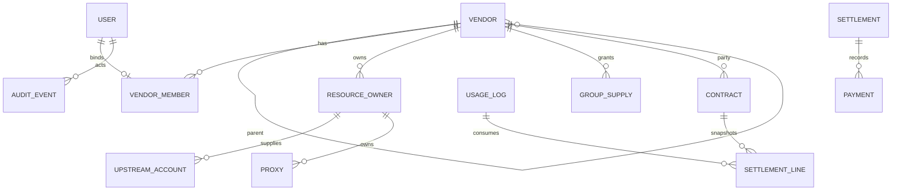

# 领域模型与数据字典

## 1. 领域边界



## 2. 核心实体

### `users`

登录主体和平台用户的统一记录。现有 `vm2api` 已有 `users` 表，并通过 `role/status/deleted_at` 支持 `super_admin/admin/user`（旧数据由 047 迁移）。

目标新增或明确：

| 字段 | 规则 |
|---|---|
| `role` | 规范存储角色 `super_admin/admin/user/vendor`；供应商一级/二级层级由 active `vendor_members` 关联的 `vendors.tier` 表示 |
| `created_by` | 普通用户和管理员创建关系；缺失历史归属不能猜测 |
| `status` | `active/disabled/locked/deleted`；删除保持软删除 |
| `policy_revision` | 授权策略变更时递增，用于会话和缓存失效 |

### `vendors`

| 字段 | 类型/示例 | 约束 |
|---|---|---|
| `id` | UUID | 不复用，不从外部输入信任 |
| `name` | string | 展示名；可改但审计记录旧值 |
| `email` | string | 有效记录唯一，不区分大小写 |
| `tier` | 1/2 | 只能是一级或二级 |
| `parent_id` | nullable UUID | 一级必须为空；二级必须指向 active 一级 |
| `root_id` | UUID | 一级等于自身；二级等于一级 id |
| `status` | active/disabled/archived | 非 active 禁止新增业务写入 |
| `groups` | 集合 | 二级必须是父级集合子集 |
| `platforms` | 集合 | 二级必须是父级集合子集 |
| `account_limit` | positive integer | 不超过父级额度 |
| `proxy_limit` | positive integer | 不超过父级额度 |
| `child_limit` | non-negative integer；`0` 表示不限制 | 仅一级有效 |
| `capability_revision` | integer | 能力变更时递增 |
| `created_by` | user id | 记录创建者 |
| `created_at/updated_at` | timestamp | UTC 存储 |

### `vendor_members`

把用户身份绑定到供应商主体。字段至少包括 `user_id`、`vendor_id`、`status`、`is_primary`、`created_by`、`created_at`。成员撤销不能删除供应商历史资源和账单；旧会话必须失效或在下一次请求被拒绝。

### `resource_owners`

统一表达资源所属的用户、供应商或平台池。现有 VM 的 `owner_user_id/origin` 是重要事实来源，迁移时要增加供应商归属而不是覆盖旧字段：

```text
owner_type = platform | user | vendor
owner_id   = null | users.id | vendors.id
origin     = platform | admin_assigned | user_created | vendor_created | imported
```

资源必须只有一个主 owner；共享供给另用 `resource_grants` 表表达，避免把共享关系编码到 owner 字段。

### `resource_grants`

供应商向平台或下游授予分组、模型、账号或代理的使用资格。至少包括 `resource_id`、`grantor_vendor_id`、`grantee_type/id`、`group_id`、`status`、`effective_at`、`revoked_at`、`revision`。撤销必须在真实派发前重新检查，缓存命中不能绕过撤销。

### `contracts`

合同是一条有方向的付款边，不能用一个供应商倍率替代：

| 字段 | 说明 |
|---|---|
| `leg` | `platform_to_l1` 或 `l1_to_l2` |
| `payer_id/payee_id` | 付款方和收款方；平台可用保留 id `0` |
| `version` | 价格、倍率和条件快照版本 |
| `effective_at` | 用量发生时间按此选取有效合同 |
| `price_cny_per_usd` | 采购价格 |
| `fx_cny_per_usdt` | 付款换算价 |
| `multiplier` | 业务倍率；使用前校验正数和精度 |
| `status` | draft/active/expired/void |

新账公式：

```text
USDT = 消费成本 USD × 采购价 CNY/USD ÷ 付款换算价 CNY/USDT
```

历史结算行保存合同版本、汇率、倍率和原始用量快照，不因当前合同变化而重算。

### `usage_facts` / `settlement_lines`

`usage_facts` 记录请求事实：请求、输入、输出、缓存读写、模型、供应商、账号、分组、时间和结算根。`settlement_lines` 只引用已经冻结的用量事实和合同快照，并带唯一幂等键，例如 `leg + usage_fact_id + contract_version`。

### `settlements` / `payments`

结算单负责状态和金额，付款流水负责实际登记与冲正。付款动作不能直接修改结算金额；调整单要带原因、操作者、前后值和审计事件。

## 3. 状态字典

| 对象 | 状态 | 语义 |
|---|---|---|
| 供应商 | `active` | 可登录、可读、可执行允许写操作 |
| 供应商 | `disabled` | 保留历史，只读或拒绝，禁止新业务写入 |
| 供应商 | `archived` | 永久历史态；资源和账单只读 |
| 资源 | `active` | 可以按授权参与调度 |
| 资源 | `paused` | 人工暂停；不能被调度但可恢复 |
| 资源 | `archived` | 历史只读，不能普通恢复 |
| 结算单 | `draft/review` | 尚未确认付款 |
| 结算单 | `confirmed/partial/paid` | 收款方确认、部分付款或已付款 |
| 结算单 | `disputed/void` | 争议或作废；作废保留原记录 |

## 4. 一致性要求

- 所有唯一性、父子约束和合同生效约束由数据库约束加服务事务双重保证。
- 余额、用量和付款流水不允许通过普通 `PATCH` 直接 set；必须使用带幂等键的领域命令。
- Redis 只做缓存、限流、租约和短期协调，不能作为供应商归属、合同和账单的唯一事实来源。
- 删除采用软删除或归档；历史用量、结算和审计的外键语义必须保留。
