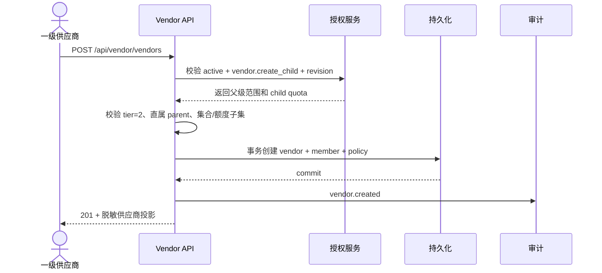
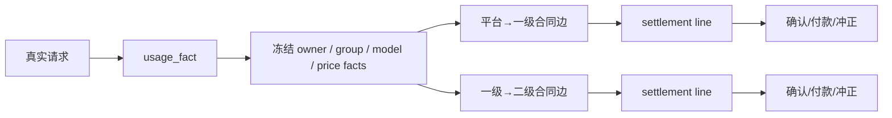

# 业务流程与状态机

## 1. 创建下级供应商



任何一步失败都不创建半成品账号。并发开户必须用唯一约束和父级锁/CAS 保护 `child_limit`，重复请求可用幂等键返回同一结果。

## 2. 供应商资源生命周期

```text
draft -> active -> paused -> active
                    |
                    v
                 archived
```

- `draft` 只在导入预览或授权会话中存在，不能参与调度。
- `active` 仍需满足凭据、代理、分组、模型、额度、并发和平台故障资格。
- `paused` 是供应商或平台的业务暂停，恢复需要重新做资格检查。
- `archived` 进入历史只读；请求、用量、合同和审计保留。
- 系统自动禁调度和供应商手工暂停分别记录原因，不能用手工开关覆盖确定性故障。

## 3. 供应商停用与级联

1. 超级管理员或有委派能力的管理员提交停用命令，带理由和 `expected_revision`。
2. 服务事务把供应商标为 `disabled`，递增 capability/policy revision，撤销新资源写入资格。
3. 已有会话在下一次敏感请求复核 revision；活动请求按现有网关取消/排空策略结束。
4. 直属二级供应商进入受限状态。历史用量和账单仍可按只读策略查看。
5. 恢复必须重新确认父级 active、合同状态、凭据和代理资格，不自动恢复已归档资源。

## 4. 用量到结算



结算步骤：

1. 按用量发生时间选择有效合同版本；
2. 保存成本、模型、分组、账号、供应商、合同、汇率和倍率快照；
3. 按付款边独立生成结算行和幂等键；
4. 付款方发起、收款方确认，争议和作废不覆盖原事实；
5. 付款登记和冲正写入独立流水，最终金额由流水和调整单可重算；
6. 导出使用稳定快照，不在导出时按当前合同重算旧账。

## 5. 供应商与平台资源绑定

资源绑定必须在一个事务内检查：供应商 active、资源 owner、账号授权、group/platform、代理、平台策略和当前 revision。绑定成功不恢复暂停、失效凭据或其他健康状态。供应商无法通过将资源绑定到平台来扩大权限，也不能从其他树借用资源。

供应商账号开户的实际顺序是：创建账号资源和配对 VM 资源 → 写入系统默认 VM 配置 → 将供应商代理同步到统一代理池 → 绑定代理和分组 → 尝试启动运行时 → 打开匹配的授权面板。自动启动失败必须作为结构化结果返回并保留停止状态，不能把预配成功当成运行成功。代理池中的 `vendor_id` 和 `vendor_resource_id` 是供应商代理归属事实；运营端可以读取全量，供应商侧只能使用自己的归属记录。

## 6. 撤销与竞态

以下变化必须在真实派发前重新检查：供应商停用、成员移除、能力撤销、资源归档、分组移除、合同失效和凭据轮换。缓存只用于减少读取，不是授权事实。迟到的异步任务要携带 claim/revision/nonce，旧 claim 不能覆盖新配置。
