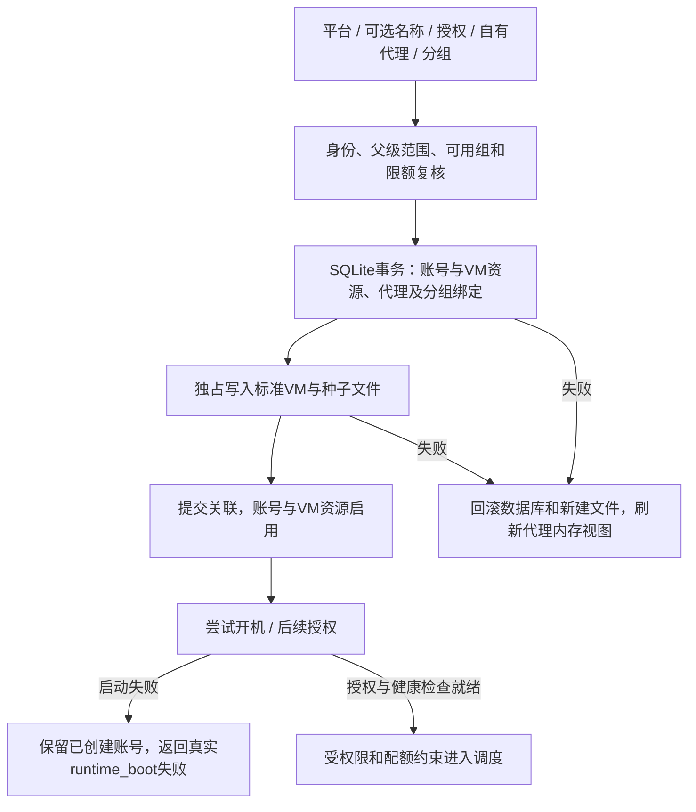

# 供应商平台前后端需求审查

审查日期：2026-10-30。初始实现为 `7daa1c94bbd15b26aa197e79b2c0883b2f24993b`；普通需求沿用上游父提交 `8cb05ff261dd6d8a7e90479463b33bc6e1585730`。审查中保留独立 main `f931765c6c95151d98e2774c0f69d34600c67479` 的版本菜单、登录页和人工发版修订。本文以用户最后确认的需求为准，取代较早文档中与当前接口冲突的描述；没有执行生产部署或数据删除。

## 依据与结论边界

- 需求依据：单一 `vendor` 角色、两级供应商、创建下级开关与0上限不限；供应商添加账号就是创建后台同一个标准VM；平台/模型分组/授权方式对应；供应商只编辑授权、分组、名称、备注和自有代理；两端共用账号池；统一上下游账单；移除工作台和供应商操作记录。
- 参考源码：定制 sub2api `0276190e775b369319acc18bc1c120a4469a71ae`，`frontend/src/features/vendor`、`docs/vendor-console/API-ROUTES.md`、`docs/ENGINEERING.md` R13。其页面、DTO、服务权限和用例用于比较；不把所有源产品扩展能力自动算成本项目已完成。
- 当前实现仍为 Node/React/SQLite，复用现有VM、代理池和授权链，不增加第二套运行VM或普通供应商交互shell。
- “已回归”指本机代码、真实SQLite/HTTP及隔离模拟数据的检查；真实OAuth、Linux guest/KVM和生产账务对账另列，不用截图或模拟测试替代。

## 全链路需求矩阵

| ID | 需求/不变量 | 前端入口 | 后端/数据权威 | 审查结论与验证 |
| --- | --- | --- | --- | --- |
| R01 | SA、AD、U、vendor分离；AD/U无供应商与VM管理权 | 路由守卫、菜单、登录 | panel-acl、VendorPlatform.identity | 已有实现保留；角色、跨范围、退出缓存清理回归 |
| R02 | 一个供应商角色；V1/V2是主体层级 | 运营供应商页、供应商管理 | vendors/vendor_members/vendor_capabilities | 两级、独立登录、不可绑定他人；当前用户名/密码表单不恢复已取消身份字段 |
| R03 | 有创建下级权限才显示管理菜单；0表示无限制 | allowedViews、创建用户/供应商表单 | createChild、父级资源/子级限额 | 已回归；有限父级不能被子级0绕过，幂等开户和撤权生效 |
| R04 | 供应商/超管账号池内容与样式统一 | 共享AccountWorkbench及详情/用量/编辑 | accountPortalRows及共享账号处理器 | 两端同一行数据/表头一致；操作范围由角色决定，非两份表格维护 |
| R05 | 添加账号创建同一个标准VM，继承全局参数 | AccountCreateForm、运营VM创建 | newVmNaming、buildNewVmRecord、vendor-vm-provisioner | 共用编号/配置；本轮同步启用账号和VM资源，跳过残留目录，防止复用旧凭据目录 |
| R06 | 创建与绑定一致；失败不消耗资源额度 | 授权开始时预配；显示真实启动结果 | createAccount事务、配置回调、VM文件补偿 | 本轮修复绑定/分组失败半成品，A01–A04及HTTP故障注入 |
| R07 | 平台/模型分组/授权方式一致，继承当前父级约束 | 平台选项、创建/编辑分组目录 | availableAccountGroups、effective_platforms、授权写入前复核 | 本轮修复无匹配组仍创建、旧父级范围仍显示，以及撤权后继续授权 |
| R08 | 只编辑五类账号配置，其他VM参数仅SA | 共享编辑弹窗；SA额外VM配置入口 | 字段白名单、归属检查、VM配置ACL | 已回归；本轮混合名称/状态更新保持账号/VM同名，失效选中组可移除不能重新选择 |
| R09 | 代理粘贴/选择一个框；只能用自己的代理 | AccountProxyInput、IP代理页 | vendorProxyAddress、统一proxy-pool映射 | URL/简写/凭据脱敏/同主体复用已回归；满额绑定失败现在原子回滚 |
| R10 | 暂停/归档/撤权不被凭据更新复活 | 调度开关、删除、重新登录 | 成对状态、vendorRuntimeBlock、实时group_resources | 本轮改查实际分组关系而非旧JSON副本；无组/无效组拒绝供给，父子/平台保护保留 |
| R11 | 冷却与额度真实，清冷却不删除真实窗口 | 详情、冷却清理、配额窗口 | account_runtime/accounts/VM快照 | 本轮保留rate_limit_reset_at及rate_limited状态；HTTP以真实配额仓储验证 |
| R12 | 真实请求/Token/费用/失败/延迟，未知不作0 | 用量页、详情、趋势、固定5H/7D/30D | usage_logs + 无重复的历史vendor_usage_facts | 本轮补日志off仍保留供给摘要；历史无缓存字段时含缓存Token/日缓存明确未知 |
| R13 | 下级开户可设默认及分平台采购价 | 供应商开户、运营供应商编辑 | billingProfile、合同版本快照 | 本轮补门户Anthropic/OpenAI单价输入；空项用默认，保存值与十位计算精度对齐 |
| R14 | 上游/下游账单同一菜单，新增结算只对直属下游 | BillingWorkbench、共享付款操作 | 两条独立付款边、预览/分配/付款流水 | 已有能力保留；本轮修复零金额确认状态、未知价格/平台归属及损坏合同不能静默回退 |
| R15 | 结算幂等、不可超付、不按新价格改旧账 | 先预览再生成，付款需额外授权 | 冻结合同/水位/分配，付款幂等key | 迟到补单/作废分配/确认重试/六位付款规范化已回归；无实际转账 |
| R16 | 四语、菜单、错误和关闭行为一致 | 资源词条、能力菜单、受控Dialog | 后端权限为最终依据 | 本轮锁住预配中的关闭、处理目录加载/无可用组、阻止跨平台重试误用VM；内部/启动错误不回显底层内容 |

## 可复现缺陷与修复

| 编号 | 触发和影响 | 最终实现 | 用例位置 |
| --- | --- | --- | --- |
| A01 | 所选平台没有可用授权组，仍产生账号/VM | 统一可用组查询，无匹配组409且不预配 | vendor-audit A01 |
| A02 | VM写完后代理满额/分组绑定失败，API报错却留下记录 | 配置绑定移入事务和写文件前回调；失败重载代理内存视图 | vendor-audit A02；vendor-platform HTTP满额检查 |
| A03 | 文件已经生成后数据库拒绝关联 | 创建器返回补偿动作，只删除本次拥有的文件/目录；不启动未提交VM | vendor-audit A03 |
| A04 | 已删VM的旧目录仍有凭据，自动编号再次使用 | 共用命名把目录/JSON路径纳入占用；独占建立新文件 | vendor-audit A04 |
| A05 | 真正分组与资源JSON不一致，或父级撤权后仍显示/授权 | 运行时查询实际绑定；创建/编辑目录与授权提交复核当前父级范围 | vendor-audit A05；HTTP目录/撤权 |
| A06 | 日志off导致非商业调用使用供应商VM后没有供应商摘要；裁剪后缓存变0 | 供给摘要保留但不写请求正文；历史未知缓存和含缓存Token保留未知标记 | vendor-audit A06 |
| A07 | 零金额草稿确认后一直待付款，无法登记0元付款 | 确认为paid，重复确认稳定，不造0金额流水 | vendor-settlements A07 |
| A08 | 未定价且Token为0的成功记录被筛掉 | 未定价参与检测，摘要未知，预览拒绝 | vendor-settlements A08 |
| A09 | 按平台计价时历史用量缺少归属，悄悄使用默认单价 | 有平台价格但无有效归属时拒绝猜价 | vendor-settlements A09 |
| A10 | 付款精度、重复请求需要边界验证 | 保留既有六位规范化行为，验证最小单位/非有限金额/规范化后幂等 | vendor-settlements A10（验证已有行为） |
| A11 | 存储的合同价格JSON损坏被当成空配置 | 显式错误，不用默认价代替损坏合同 | vendor-settlements A11 |
| A12 | 可保存结算算法无法接受的极小/极大/布尔参数 | 入库前范围校验和十位小数规范化，无半成品登录 | vendor-audit A12 |
| A13 | 同时提交name/status时名称没有同步到运行VM | 账号更新归到同一事务处理；关联VM同步，错误回滚 | vendor-platform HTTP Atomic rename |
| A14 | 清除临时冷却同时抹掉官方限流到期时间 | 保留真实rate-limit窗口和状态，测试实际AccountsRepo/RuntimeRepo | vendor-platform HTTP audit-quota |
| A15 | 编辑只能看到当前可选组，已撤权旧选择无法取消 | 账号专用目录；已选失效组只允许取消选择 | portal-model测试与两端账号groups HTTP |

审查中也确认了未需修改的行为：默认账期已经按浏览器本地自然日计算且默认结算到昨天；付款已有六位规范化；退出登录清理查询缓存；日志没有关闭商业计费；供应商没有普通shell权限。这些结论有源码/回归依据，没有为制造改动重复实现。

## 创建状态与失败边界

同步预配失败与提交后的启动失败是不同状态。后者不删除已创建资源，更不能把无法确定的外部运行状态误当作已回滚。当前补偿覆盖单网关进程的同步配置/文件异常；进程崩溃、磁盘故障、多进程竞争和外部OAuth任务的完整恢复仍需独立设计/验收。

## 数据与升级说明

本轮没有新增迁移、没有改写已应用的迁移或清理生产数据。保留既有070结算预览/分配模型与历史账单、付款、用量。新接口为两端对应的 `accounts/:id/groups`；响应增加 `effective_platforms`，`total_tokens` 在缓存字段不完整时可为null，趋势提供cache_complete。

- 历史无组、失效组或不符合供应商/父级授权的VM将拒绝调度和新的凭据写入；应由超级管理员核对真实归属并配置合法组，不自动扩大权限。
- 已经存在的半成品不会被本次升级自动删除。可读查询发现关联缺失后，由运营确认恢复或归档。
- 历史请求日志已经裁剪而供应商事实未保存的缓存/延迟/失败明细不可凭空重建；显示未知，账单不猜测费用。
- 单价、汇率、倍率为正数，按现有算法十位精度入库，支持值小于1e12且规范化后非0；非法存量合同会停止新预览，需要修复，不重算已发账单。
- 日志off仍保留供应商供给的普通统计摘要和成功计费事实，不保留请求正文或调试正文。

## 未完成能力与验收限制

以下不应被页面存在或本轮测试数字掩盖：

| 类型 | 事项 | 完成前需要的证据/决定 |
| --- | --- | --- |
| 真实环境验收 | 实际OAuth/CLI、真实代理、Docker/KVM开机与换绑、额度重置 | 授权测试账号和Linux运行环境；供应商/超管双端及请求链核对 |
| 真实环境验收 | 持久化重启、升级恢复、大数据量和持续负载 | 数据备份、故障演练、负载与资源记录；本轮无生产结论 |
| 扩展规划 | 下级自助编辑/停用、批量账号导入/凭据导出、代理编辑/检测/质量 | 逐字段委派、作用域和安全交互明确后实施；当前未提供这些入口 |
| 扩展规划 | 任意业务分组价格优先级、跨合同自动拆单、退款冲正/收款争议/导出 | 财务规则、快照与幂等引用、账务验收；当前仅平台价和既有结算闭环 |
| 工程待完善 | 跨进程claim/CAS、异步授权撤销恢复、失败事件完整审计 | 竞争/崩溃注入与运维恢复步骤；同步补偿不等于分布式事务 |
| 配置验收 | 凭据存储加密、会话/MFA、独立域名部署 | 数据库密钥/文件权限与生产配置核验；现有字段脱敏不等于确认所有存储已加密 |

详见 [可执行测试用例](13-platform-test-cases.md)。以上扩展不被静默删除，也没有被写成“已全面验收”。

## 2026-10-30 结算机制最终修订（当前有效）

前文涉及“按供应商维护采购单价、汇率、倍率或币安 ID”的描述均为历史方案，当前实现以 [14-global-settlement-pricing.md](14-global-settlement-pricing.md) 为准。所有供应商共用超级管理员维护的全局 OpenAI 单价、Claude 单价、结算汇率和生效日期；新建/编辑用户、供应商和账单预览不再接收这些字段。

本轮补齐了全局规则 API、上海时间生效边界、相同生效日版本优先、跨版本按请求发生时间分段、账单价格快照和历史付款边归属。供应商门户和运营后台账单都显示价格版本明细。旧合同只读兼容首个全局生效日前的历史用量，新供应商不会隐式生成独立价格合同。定向单元与供应商 HTTP 回归已覆盖权限、幂等、边界、两条付款边和旧账单冻结。
